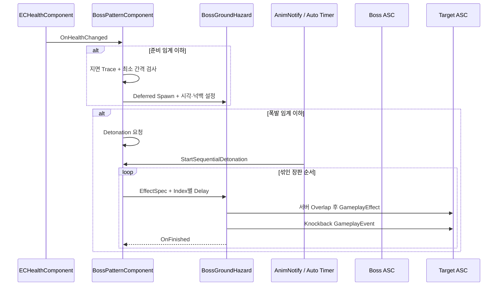
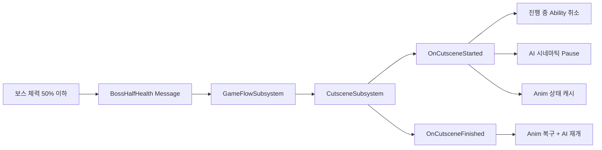

# Boss Battle

[← GAS Combat](GAS_Combat.md) · [README](../README.md) · [Game Flow →](GameFlow.md)

## 검증 기준

보스 Character, 체력 임계 패턴 Component, 장판 Actor, 돌진·도약 Ability, GameFlow 메시지 연결의 C++는 확인했습니다. 보스 StateTree, Ability Blueprint, Montage, 컷씬, Niagara, Sound, Decal 에셋은 포함되지 않아 실제 배치와 연출은 검증되지 않았습니다.

## 1. 구현 목적과 요구사항

- 보스 Character가 전투 패턴 자체와 전체 게임 진행 정책을 직접 떠안지 않도록 책임을 분리한다.
- 체력 임계점에 도달하면 플레이어 주변에 위험 지대를 준비하고 순차 폭발시킨다.
- 큰 단일 피해로 임계점을 건너뛰어도 준비 후 폭발 순서가 유지되게 한다.
- 돌진 시작, NavMesh 이동, 도약 공격, 이동 모드 복구를 하나의 Ability 흐름으로 관리한다.
- 보스 페이즈·사망 컷씬 중 AI, 공격 Ability, 애니메이션, 가시성을 정리하고 종료 후 복구한다.
- 플레이어 재도전 시 보스 체력과 1회성 패턴 상태를 초기화한다.

## 2. 핵심 클래스와 책임

| 클래스 | 책임 | 코드 |
|---|---|---|
| `AECEnemyBoss` | 체력 변화 메시지, 반피·사망 컷씬 반응, AI 일시 정지, 애니메이션·가시성 복구, 재도전 패턴 초기화 | [ECEnemyBoss.h](../EmptyCity/Character/Enemy/ECEnemyBoss.h), [cpp](../EmptyCity/Character/Enemy/ECEnemyBoss.cpp) |
| `UECBossPatternComponent` | 준비·폭발 임계값, 장판 위치 탐색, 순서 셔플, EffectSpec 생성, 완료·정리 | [BossPatternComponent.h](../EmptyCity/Character/Enemy/Component/BossPatternComponent.h), [cpp](../EmptyCity/Character/Enemy/Component/BossPatternComponent.cpp) |
| `AECBossGroundHazard` | 경고 Decal, 지연 폭발, 서버 피격 판정, GameplayEffect·넉백 이벤트, 연출 Multicast | [ECBossGroundHazard.h](../EmptyCity/Character/Enemy/Pattern/ECBossGroundHazard.h), [cpp](../EmptyCity/Character/Enemy/Pattern/ECBossGroundHazard.cpp) |
| `UECGameplayAbility_BossSprintLeapSlam` | 발동 거리 검사, Crouch→Sprint→LeapSlam 단계, NavMesh 이동, Root Motion 이동 모드 복구 | [ECGameplayAbility_BossSprintLeapSlam.h](../EmptyCity/AbilitySystem/Ability/Enemy/ECGameplayAbility_BossSprintLeapSlam.h), [cpp](../EmptyCity/AbilitySystem/Ability/Enemy/ECGameplayAbility_BossSprintLeapSlam.cpp) |
| `UECAnimNotify_BossPatternDetonation` | Montage의 지정 프레임에서 순차 폭발 시작 요청 | [ECAnimNotify_BossPatternDetonation.h](../EmptyCity/Animation/Notify/ECAnimNotify_BossPatternDetonation.h), [cpp](../EmptyCity/Animation/Notify/ECAnimNotify_BossPatternDetonation.cpp) |
| `UECGameFlowSubsystem` | 반피·사망 메시지를 컷씬 재생 정책으로 연결하고 재도전 상태 복원 | [ECGameFlowSubsystem.cpp](../EmptyCity/Subsystem/ECGameFlowSubsystem.cpp) |

## 3. 호출·이벤트 흐름

### 체력 임계 장판 패턴

### 페이즈 컷씬 조정

## 4. 기술적 설계와 구현 방식

### 패턴 상태를 보스 인스턴스에 귀속

`UECBossPatternComponent`는 준비·요청·시작·완료 상태를 보스 인스턴스별로 관리합니다. 현재 C++ 기본값은 체력 75%에서 장판 준비, 50%에서 폭발 요청이며 Blueprint 기본값에서 덮어쓸 수 있습니다. 체력이 거의 최대치로 복원되면 재도전으로 보고 상태를 초기화하는 경로도 있습니다.

큰 피해로 준비 임계점을 지나 바로 폭발 임계점 아래로 내려가면 `PrepareHazards()`를 먼저 호출한 뒤 `RequestDetonation()`을 수행합니다.

### 지면과 간격을 고려한 장판 배치

플레이어 또는 AI TargetActor 주변의 원형 범위에서 후보 위치를 뽑고 아래 방향 Trace를 수행합니다. 표면 Normal.Z가 기준 이상인지, 기존 장판과 2D 거리가 최소 간격 이상인지 검사한 뒤 표면 Normal에 맞춰 회전시킵니다. 설정된 시도 횟수 안에 위치를 찾지 못한 장판은 건너뜁니다.

### 서버 판정과 클라이언트 연출

장판 Actor는 복제되며 서버에서 지연 폭발과 Overlap 판정을 수행합니다. 수평 반경과 높이 차이를 별도로 검사하고 같은 Actor를 한 번만 처리합니다. 적대 팀 대상의 ASC에 EffectSpec을 적용하고 넉백 GameplayEvent를 보냅니다. 폭발 VFX·SFX는 Multicast에서 재생합니다.

### 돌진·도약 Ability의 단계 관리

Ability는 발동 거리, 필수 Montage Section, AIController·Target·MovementComponent를 먼저 검증합니다. Sprint 시작 전 보스와 목표 지점을 NavMesh에 투영하고, 시작점이 NavMesh에서 너무 멀면 취소합니다. 목표 거리 안으로 들어오면 이동을 멈추고 대상 방향으로 회전한 뒤 도약 Montage 동안만 `Flying`을 사용합니다. 종료·취소 시 속도, Focus, 이동 모드를 복구합니다.

### 컷씬과 전투 상태의 분리

보스는 체력 임계·사망 사실을 Gameplay Message로 알리고, 컷씬 재생 결정은 GameFlow가 담당합니다. 컷씬 시작 시 진행 중 Ability를 취소하고 AI를 시네마틱 이유로 정지합니다. 사망 컷씬 동안 실제 전투 보스를 숨겼다가 종료 후 사망 완료 흐름을 이어갑니다.

## 5. 코드 링크와 커밋 근거

### 주요 코드

- [ECEnemyBoss.cpp](../EmptyCity/Character/Enemy/ECEnemyBoss.cpp)
- [BossPatternComponent.cpp](../EmptyCity/Character/Enemy/Component/BossPatternComponent.cpp)
- [ECBossGroundHazard.cpp](../EmptyCity/Character/Enemy/Pattern/ECBossGroundHazard.cpp)
- [ECGameplayAbility_BossSprintLeapSlam.cpp](../EmptyCity/AbilitySystem/Ability/Enemy/ECGameplayAbility_BossSprintLeapSlam.cpp)
- [ECAnimNotify_BossPatternDetonation.cpp](../EmptyCity/Animation/Notify/ECAnimNotify_BossPatternDetonation.cpp)
- [ECGameFlowSubsystem.cpp](../EmptyCity/Subsystem/ECGameFlowSubsystem.cpp)

### 현재 포트폴리오 저장소 스냅샷

- [`8c42eb5` — 2026-06-10 클래스 스냅샷](https://github.com/Fsbsnw/EmptyCity/commit/8c42eb588f95f9a5514529fd59032e36a58f696c)
- [`06a7c55` — 2026-10-22 최종 코드 스냅샷](https://github.com/Fsbsnw/EmptyCity/commit/06a7c55f5e730dd910af7156541670a4addce4e2)

현재 저장소에서 보스 관련 파일은 위 두 스냅샷에만 직접 나타납니다. 원본 팀 저장소의 세부 페이즈·패턴·컷씬 커밋은 이력에 포함되지 않았으므로 개발 순서를 현재 저장소에서 복원할 수 없습니다.

## 6. 기여 구분

- 원본 팀 저장소의 로컬 Git 메타데이터상 현재 `ECEnemyBoss`, `BossPatternComponent`, `ECBossGroundHazard`, `BossSprintLeapSlam` 파일에는 `Fsbsnw` 변경이 집중되어 있었습니다.
- Git 메타데이터는 직접 수작업 작성 또는 AI 비사용을 증명하지 않습니다. 지원자는 AI 생성·수정 범위를 별도로 확인해야 합니다.
- 보스 패턴은 팀의 GAS, HealthComponent, AIController, Cutscene, Message 기반 위에서 동작합니다. 이 기반 전체를 개인 구현으로 표현하지 않습니다.
- 보스 StateTree, Montage, VFX/SFX, Cutscene 에셋이 없어 해당 에셋 제작·연출 기여는 이 저장소로 판단하지 않습니다.

## 7. 구현 결과와 기술적 한계

### 코드로 확인되는 결과

- 체력 변화와 패턴 상태, 게임 전체 컷씬 정책이 분리되어 있습니다.
- 임계점 건너뛰기, 위치 탐색 실패, 재도전, 보스 사망 시 정리 경로가 있습니다.
- 장판 판정은 서버, VFX·SFX는 Multicast로 나뉩니다.
- Sprint와 LeapSlam의 NavMesh·Focus·MovementMode 정리 경로가 있습니다.

### 한계와 확인 필요 사항

- 실제 보스 StateTree에서 어떤 조건으로 Ability를 선택하는지 확인할 수 없습니다.
- 임계값·장판 수·반경·폭발 간격은 C++ 기본값이며 실제 Blueprint에서 변경됐을 수 있습니다.
- DamageEffect, Montage, Decal, Niagara, Sound, Cutscene DataAsset이 없어 완성 연출을 재현할 수 없습니다.
- `ResolvePatternTarget()`과 GameFlow 일부가 첫 번째 플레이어에 의존하므로 다중 플레이어 동작은 검증되지 않았습니다.
- 네트워크 환경에서의 패턴 동기화·지연·재접속 테스트 결과는 없습니다.

