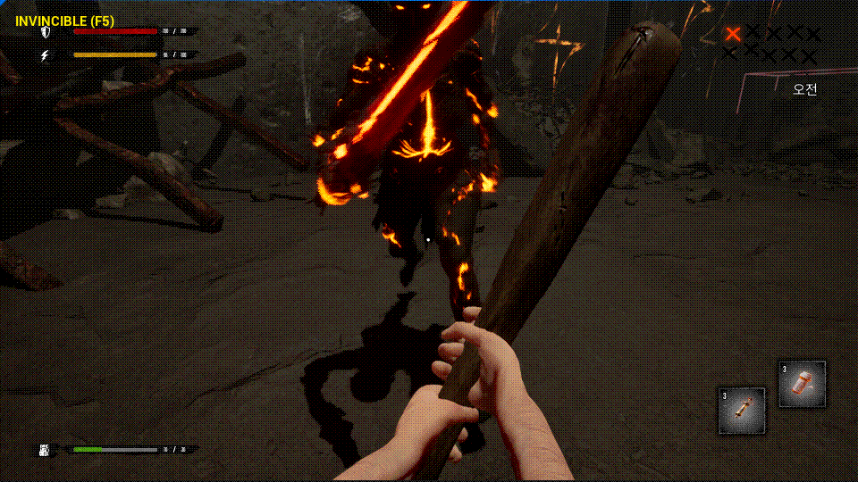
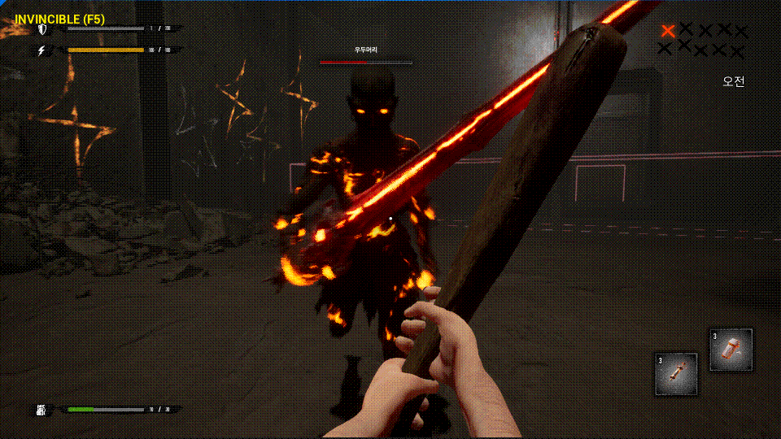
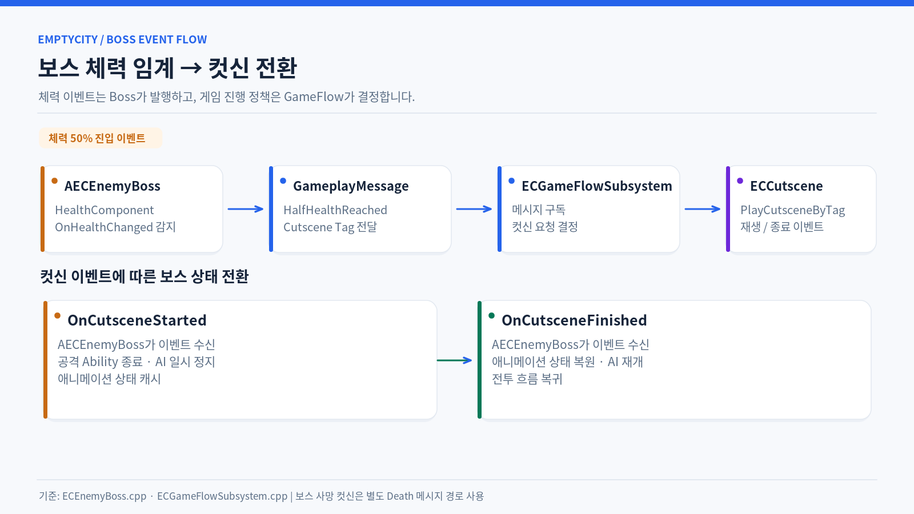

# 보스 패턴과 페이즈 전환

[← README](../README.md)

보스의 행동 패턴과 체력 임계 이벤트, 전투 연출을 기존 GAS·StateTree·컷신 흐름에 연결했습니다.

> 

## 대표 패턴

- **체력 임계 장판:** 임계점에서 위험 지대 위치를 정하고 순차 폭발을 실행합니다. 서버 피해 판정과 클라이언트 VFX/SFX 표현을 구분합니다.
- **페이즈 컷신:** 체력 변화를 메시지로 전달하고, 컷신 동안 AI·Ability를 정리한 후 전투로 복귀합니다.

> 
> 

## 주요 코드

- [ECEnemyBoss.cpp](../EmptyCity/Character/Enemy/ECEnemyBoss.cpp)
- [BossPatternComponent.cpp](../EmptyCity/Character/Enemy/Component/BossPatternComponent.cpp)
- [BossSprintLeapSlam.cpp](../EmptyCity/AbilitySystem/Ability/Enemy/Boss/BossSprintLeapSlam.cpp)
