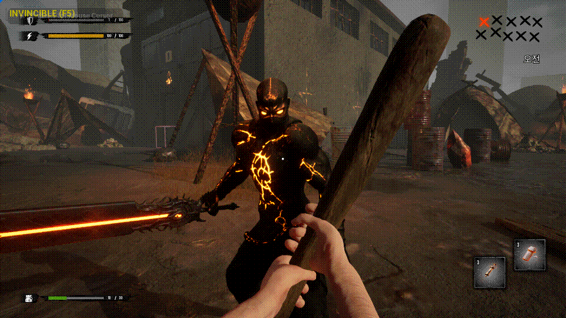

# GAS 기반 적 전투

[← README](../README.md) · [StateTree AI](StateTree_AI.md)

팀의 GAS 공통 기반 위에서 적 공격 Ability, 패링, 피격 반응과 피드백을 연결했습니다.

> 

## 전투 파이프라인

`StateTree → 공격 Ability/몽타주 → 근접 Trace → 패링 또는 Damage GE → ExecCalc → 피격·GameplayCue`

- 유효 공격 구간에서 Trace를 실행하고 한 공격의 중복 적중을 제한합니다.
- 패링 가능 상태와 방향을 판단해 일반 피해와 패링 반응을 분기합니다.
- 패링 발생 시 공격 판정을 정리하되 반응이 끝날 때 Ability를 종료해 StateTree 행동 전환 시점을 맞춥니다.
- GameplayTag·SetByCaller로 피해 관련 값을 전달하고, ExecCalc와 GameplayCue로 계산 및 피드백을 연결합니다.

## 주요 코드

- [ECEnemyDamageAbility_Melee.cpp](../EmptyCity/AbilitySystem/Ability/Enemy/ECEnemyDamageAbility_Melee.cpp)
- [ECEnemyDamageAbility.cpp](../EmptyCity/AbilitySystem/Ability/Enemy/ECEnemyDamageAbility.cpp)
- [ECExecCalc_Damage.cpp](../EmptyCity/AbilitySystem/ExecutionCalculation/ECExecCalc_Damage.cpp)
