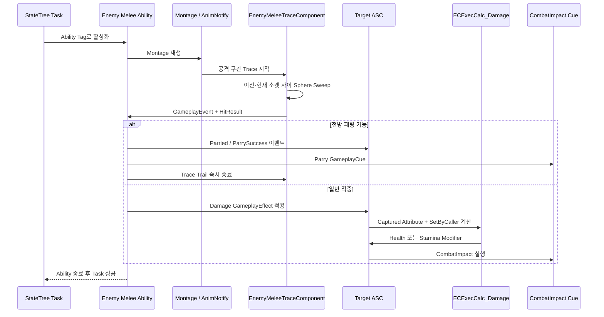

# GAS Combat

[← StateTree AI](StateTree_AI.md) · [README](../README.md) · [Boss Battle →](Boss_Battle.md)

## 검증 기준

이 문서는 적 공격 Ability, Trace Component, Damage ExecCalc, GameplayCue의 C++ 호출 경로를 기준으로 합니다. GameplayEffect Blueprint, Ability 설정 에셋, Montage, 충돌 프리셋, 전투 피드백 DataAsset 인스턴스는 저장소에 없어 값과 연결 상태를 검증하지 못했습니다.

## 1. 구현 목적과 요구사항

- AI의 행동 선택과 실제 공격 실행을 분리하고, 공격을 GAS Ability 단위로 관리한다.
- Montage의 유효 공격 구간에만 Trace를 켜고 한 번의 공격에서 같은 대상을 중복 처리하지 않는다.
- 패링 가능 상태와 공격 방향을 함께 검사해 패링과 일반 피격을 분기한다.
- 공격력·배율·스태미나 피해를 `SetByCaller`와 GameplayTag로 전달해 ExecCalc에서 계산한다.
- 타격 종류와 부위에 따른 Hit Stop, VFX, SFX, HitReaction을 GameplayCue에서 선택한다.
- 패링 반응 중 StateTree가 다음 행동으로 넘어가지 않도록 Ability의 논리적 종료 시점을 맞춘다.

## 2. 핵심 클래스와 책임

| 클래스 | 책임 | 코드 |
|---|---|---|
| `UECGameplayAbility` | 활성화 정책·그룹 등 프로젝트 GAS Ability 공통 기반 | [ECGameplayAbility.h](../EmptyCity/AbilitySystem/Ability/ECGameplayAbility.h) |
| `UECEnemyDamageAbility` | 공격 Montage Task, Damage EffectSpec 구성, 공격 종료 시 공통 정리 | [ECEnemyDamageAbility.h](../EmptyCity/AbilitySystem/Ability/Enemy/ECEnemyDamageAbility.h), [cpp](../EmptyCity/AbilitySystem/Ability/Enemy/ECEnemyDamageAbility.cpp) |
| `UECEnemyDamageAbility_Melee` | GameplayEvent 적중 수신, 전방 패링 판정, 데미지·넉백 분기, Trace·Trail 정리 | [ECEnemyDamageAbility_Melee.h](../EmptyCity/AbilitySystem/Ability/Enemy/ECEnemyDamageAbility_Melee.h), [cpp](../EmptyCity/AbilitySystem/Ability/Enemy/ECEnemyDamageAbility_Melee.cpp) |
| `UEnemyMeleeTraceComponent` | 소켓의 이전·현재 위치를 잇는 다중 Sphere Sweep, 공격별 중복 적중 방지, HitResult 이벤트 전송 | [EnemyMeleeTraceComponent.h](../EmptyCity/Character/Enemy/Component/EnemyMeleeTraceComponent.h), [cpp](../EmptyCity/Character/Enemy/Component/EnemyMeleeTraceComponent.cpp) |
| `UECExecCalc_Damage` | 공격력·무기 공격력·배율 계산, 가드 시 스태미나 피해와 일반 체력 피해 분기 | [ECExecCalc_Damage.h](../EmptyCity/AbilitySystem/ExecCalc/ECExecCalc_Damage.h), [cpp](../EmptyCity/AbilitySystem/ExecCalc/ECExecCalc_Damage.cpp) |
| `UECGameplayCue_CombatImpact` | Tag와 HitResult로 피드백 데이터 선택, Hit Stop·VFX·SFX·약한 피격 반응 실행 | [ECGameplayCue_CombatImpact.h](../EmptyCity/AbilitySystem/GameplayCue/ECGameplayCue_CombatImpact.h), [cpp](../EmptyCity/AbilitySystem/GameplayCue/ECGameplayCue_CombatImpact.cpp) |
| `UECGameplayAbility_Parried` | 패링 반응 Montage를 관리하고 종료 시 공격 Ability 그룹 정리 | [ECGameplayAbility_Parried.h](../EmptyCity/AbilitySystem/Ability/Enemy/ECGameplayAbility_Parried.h), [cpp](../EmptyCity/AbilitySystem/Ability/Enemy/ECGameplayAbility_Parried.cpp) |
| `UWeaponTrailComponent` | 공격 구간 Weapon Trail 활성·비활성 | [WeaponTrailComponent.h](../EmptyCity/Equipment/Weapon/WeaponTrailComponent.h), [cpp](../EmptyCity/Equipment/Weapon/WeaponTrailComponent.cpp) |

## 3. 호출·이벤트 흐름

### 패링 시 종료 순서

## 4. 기술적 설계와 구현 방식

### Montage 구간과 판정의 분리

공격 Ability는 Montage 생명주기를 소유하고, `UEnemyMeleeTraceComponent`는 AnimNotify가 지정한 유효 구간에서만 활성화됩니다. Trace는 시작·끝 소켓의 프레임 간 이동을 각각 Sphere Sweep하고, 이미 맞은 Actor를 기록해 같은 공격의 중복 처리를 막습니다. 적중 결과는 GameplayEvent Payload의 `HitResult`로 Ability에 돌아갑니다.

프로젝트의 `EC_MeleeTrace` 충돌 Profile 이름은 코드에서 확인되지만 `DefaultEngine.ini`가 없어 실제 채널 설정은 검증되지 않았습니다.

### 패링 판정

Melee Ability는 대상의 패링 Window 상태를 확인한 뒤 공격자와 대상 방향의 내적을 계산합니다. 현재 코드의 기준값은 `0.5`로, 대상 전방 약 120도 범위에서 들어온 공격만 패링으로 분기합니다. 이 값은 현재 C++에서 확인되는 기본 로직이며 실제 플레이 감각 검증 자료는 없습니다.

### EffectSpec과 ExecCalc

Ability는 Instigator, SourceObject, HitResult를 EffectContext에 넣고 공격자·무기·공격 유형 Tag와 `SetByCaller` 값을 EffectSpec에 추가합니다. `UECExecCalc_Damage`는 Source 공격력과 무기 공격력을 합산한 뒤 배율을 적용합니다. 대상이 가드 중이고 스태미나가 남아 있으면 스태미나 감소로, 그렇지 않으면 체력 감소로 Modifier를 출력합니다.

### Root Motion 이동 모드

기본 적 공격 Ability는 Montage에 의미 있는 수직 Root Motion이 있는 경우에만 MovementMode를 `Flying`으로 바꾸고 종료 시 복구합니다. 보스의 돌진·도약 Ability는 도약 단계에 들어갈 때만 직접 전환합니다.

### 전투 피드백의 데이터 분리

CombatImpact Cue는 EffectContext와 GameplayTag를 사용해 피드백 DataAsset의 항목을 찾습니다. 코드에는 Hit Stop 큐잉, 부위별 VFX 부착 방식, Sound, 약한 HitReaction 호출 경로가 있습니다. 실제 Niagara·Sound·Bone Profile 값은 DataAsset 미포함으로 검증되지 않았습니다.

## 5. 코드 링크와 커밋 근거

### 주요 코드

- [ECEnemyDamageAbility.cpp](../EmptyCity/AbilitySystem/Ability/Enemy/ECEnemyDamageAbility.cpp)
- [ECEnemyDamageAbility_Melee.cpp](../EmptyCity/AbilitySystem/Ability/Enemy/ECEnemyDamageAbility_Melee.cpp)
- [EnemyMeleeTraceComponent.cpp](../EmptyCity/Character/Enemy/Component/EnemyMeleeTraceComponent.cpp)
- [ECExecCalc_Damage.cpp](../EmptyCity/AbilitySystem/ExecCalc/ECExecCalc_Damage.cpp)
- [ECGameplayCue_CombatImpact.cpp](../EmptyCity/AbilitySystem/GameplayCue/ECGameplayCue_CombatImpact.cpp)
- [ECCombatFeedbackDataAsset.h](../EmptyCity/Data/Combat/ECCombatFeedbackDataAsset.h)
- [ECGameplayAbility_Parried.cpp](../EmptyCity/AbilitySystem/Ability/Enemy/ECGameplayAbility_Parried.cpp)

### 현재 포트폴리오 저장소 스냅샷

- [`8c42eb5` — 2026-06-10 클래스 스냅샷](https://github.com/Fsbsnw/EmptyCity/commit/8c42eb588f95f9a5514529fd59032e36a58f696c)
- [`fd3ded4` — 2026-07-03 코드 스냅샷](https://github.com/Fsbsnw/EmptyCity/commit/fd3ded4a1cbdeef1fe6ac18e3b137b8dedecfd45)
- [`df17ff3` — 2026-08-31 코드 스냅샷](https://github.com/Fsbsnw/EmptyCity/commit/df17ff371bd2c53fff6d3cd991eb4414187c2116)
- [`20de598` — 2026-08-31 코드 수정 스냅샷](https://github.com/Fsbsnw/EmptyCity/commit/20de5987be833d1f72d26b0646a68fb2b436695b)
- [`06a7c55` — 2026-10-22 최종 코드 스냅샷](https://github.com/Fsbsnw/EmptyCity/commit/06a7c55f5e730dd910af7156541670a4addce4e2)

스냅샷 사이의 diff는 확인할 수 있지만 원본 팀 저장소의 세부 개발 커밋은 이어지지 않으므로, 각 설계가 언제·누구에 의해 처음 도입됐는지는 현재 저장소만으로 증명할 수 없습니다.

## 6. 기여 구분

| 범위 | 기여 표기 |
|---|---|
| 적 공격 Ability, Melee Trace, 패링 반응, CombatImpact 연동 | 원본 로컬 Git 메타데이터상 `Fsbsnw` 변경이 주로 확인되는 확장·연동 범위. 직접 수작업/AI 보조 여부는 별도 확인 필요 |
| `UECExecCalc_Damage` | 원본 로컬 Git 메타데이터상 `Fsbsnw`와 `meo-young` 변경이 함께 남은 공동 범위 |
| `UECGameplayAbility`, `UECAbilitySet`, `UECAbilitySystemComponent`, 다수 AttributeSet·Cost | 팀의 GAS 공용 기반이며 원본 로컬 Git 메타데이터상 `meo-young` 기여가 큰 범위 |
| 무기·Equipment 기반 | 일부 파일은 공동 변경이며, 전체 장비 구조를 개인 구현으로 표현하지 않음 |

따라서 포트폴리오에서는 “팀 GAS 기반 위에서 적 공격·패링·판정·피드백 경로를 확장·연동한 코드”로 설명하는 것이 현재 근거에 가장 부합합니다.

## 7. 구현 결과와 기술적 한계

### 코드로 확인되는 결과

- 행동 선택, 공격 실행, 판정, 수치 계산, 피드백이 서로 다른 책임으로 분리되어 있습니다.
- 공격 구간 외 판정과 한 공격 내 중복 적중을 막는 경로가 있습니다.
- 패링 시 시각 판정 정리와 논리적 Ability 종료를 분리해 StateTree 전환을 동기화합니다.
- GameplayTag와 SetByCaller로 공격 종류와 수치를 EffectSpec에 전달합니다.

### 한계와 확인 필요 사항

- GameplayEffect/Ability Blueprint와 DataAsset이 없어 실제 수치·Tag·Cue 연결을 검증할 수 없습니다.
- 충돌 Profile과 Object Channel 설정이 없어 Trace 대상 범위를 재현할 수 없습니다.
- 네트워크 권한·예측·복제에 대한 완성도와 테스트 결과는 확인되지 않았습니다.
- 전투 수치, 패링 성공률, 프레임 비용 등 정량 성과 자료는 없습니다.
- 자동화 테스트와 전투 리플레이 검증 코드는 찾지 못했습니다.

