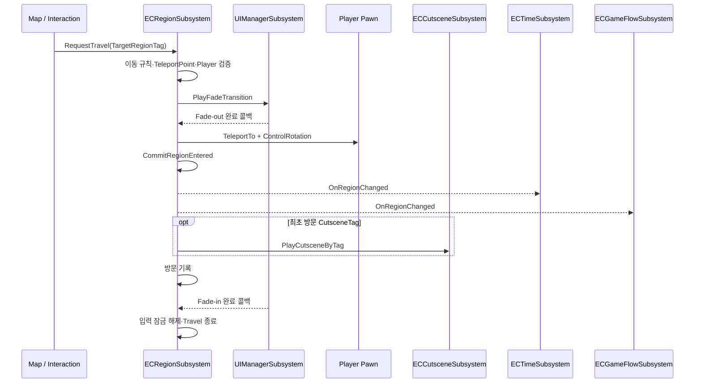
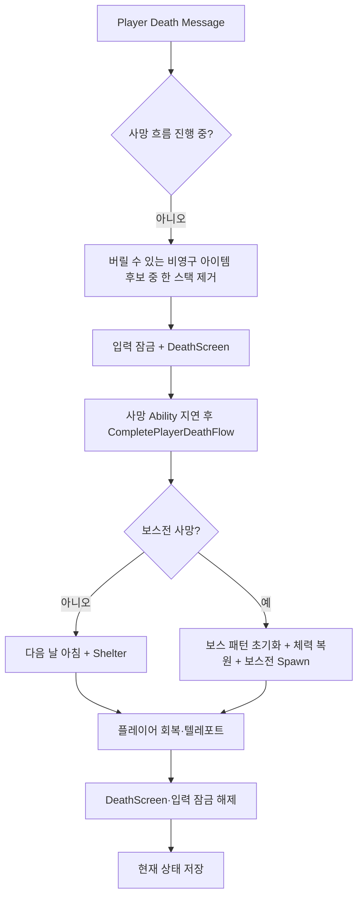

# Game Flow

[← Boss Battle](Boss_Battle.md) · [README](../README.md) · [Inventory & Loot →](Inventory_and_Loot.md)

## 검증 기준

GameFlow, Region, Time, Cutscene, Save 연동의 C++ 경로를 기준으로 작성했습니다. 지역 DataTable, Cutscene DataAsset, Level Sequence·MediaSource, 맵의 TeleportPoint, 실제 저장 슬롯은 저장소에 없어 값과 배치를 검증하지 못했습니다.

## 1. 구현 목적과 요구사항

- 지역 이동, 시간 진행, 체크포인트, 사망, 컷씬을 개별 Subsystem으로 분리하고 GameFlow가 정책을 조정한다.
- 화면이 완전히 가려진 동안 텔레포트와 최초 방문 컷씬 준비를 수행한다.
- 지역 이동 규칙과 시간 진행 규칙을 GameplayTag 기반으로 일관되게 적용한다.
- 일반 지역 사망과 보스전 사망의 복귀 규칙을 분기한다.
- 컷씬 중 입력, HUD, 플레이어와 부착 Actor, 보스 AI 상태를 안전하게 정리·복구한다.
- 아침과 보스전 진입 등 명확한 시점에 체크포인트를 저장한다.

## 2. 핵심 클래스와 책임

| 클래스 | 책임 | 코드 |
|---|---|---|
| `UECGameFlowSubsystem` | Subsystem 의존성 초기화, 죽음·보스 메시지 수신, 체크포인트 정책, 사망 복귀, 보스 컷씬 연결 | [ECGameFlowSubsystem.h](../EmptyCity/Subsystem/ECGameFlowSubsystem.h), [cpp](../EmptyCity/Subsystem/ECGameFlowSubsystem.cpp) |
| `UECRegionSubsystem` | 이동 가능 여부, Fade 텔레포트, 최초 방문, 지역 알림, 방문 기록, 리스폰 위치 | [ECRegionSubsystem.h](../EmptyCity/Subsystem/ECRegionSubsystem.h), [cpp](../EmptyCity/Subsystem/ECRegionSubsystem.cpp) |
| `UECTimeSubsystem` | Day·Morning/Afternoon/Evening, 지역 변화에 따른 시간 진행, 해금 알림, 저장·복원 | [ECTimeSubsystem.h](../EmptyCity/Subsystem/ECTimeSubsystem.h), [cpp](../EmptyCity/Subsystem/ECTimeSubsystem.cpp) |
| `UECCutsceneSubsystem` | Tag→Cutscene Data 조회, Video/LevelSequence 실행, 입력·HUD·가시성, PlayOnce 상태 저장 | [ECCutsceneSubsystem.h](../EmptyCity/Subsystem/ECCutsceneSubsystem.h), [cpp](../EmptyCity/Subsystem/ECCutsceneSubsystem.cpp) |
| `UECSaveSubsystem` | 등록된 Saveable의 런타임 데이터를 수집하고 저장·로드 | [ECSaveSubsystem.h](../EmptyCity/Save/ECSaveSubsystem.h), [cpp](../EmptyCity/Save/ECSaveSubsystem.cpp) |
| `UUIManagerSubsystem` | 지역 이동 Fade, 사망 화면, 컷씬 HUD 표시 상태 | [UIManagerSubsystem.cpp](../EmptyCity/UI/Subsystem/UIManagerSubsystem.cpp) |
| `UECGameplayMessageSubsystem` | 플레이어 사망·보스 반피·보스 사망 메시지 라우팅 | [ECGameplayMessageSubsystem.h](../EmptyCity/Subsystem/ECGameplayMessageSubsystem.h), [ECMessageTypes.h](../EmptyCity/Subsystem/ECMessageTypes.h) |

## 3. 호출·이벤트 흐름

### 지역 이동

### 플레이어 사망

## 4. 기술적 설계와 구현 방식

### Subsystem 의존성과 정책 조정

GameFlow는 초기화 시 Save, GameplayMessage, Region, Time Subsystem 의존성을 선언합니다. 직접 모든 상태를 소유하지 않고 “언제 저장할지”, “어느 지역으로 복귀할지”, “어떤 컷씬을 실행할지”를 결정합니다.

### 지역 이동 규칙

현재 코드에서 확인되는 규칙은 다음과 같습니다.

- 잘못된 Tag, 현재 지역, 이미 진행 중인 이동을 거부합니다.
- Quarry는 사용하지 않는 잠금 지역으로 처리합니다.
- 보스전 지역은 9일차 이후이며 CultistBase에서 내부 이동할 때만 허용합니다.
- 오후 이후에는 Shelter·TradingPost 및 CultistBase 내부 이동을 제외한 일반 지역 이동을 제한합니다.
- 거부 이유에 따라 알림 메시지를 보냅니다.

이 규칙의 기획 적합성은 코드로만 확인할 수 없으며, 지역 목록과 표시 정보는 DataTable 미포함입니다.

### Fade 안에서 상태 변경

이동 시작 시 PlayerController 입력을 잠그고 UIManager의 Fade를 실행합니다. Fade-out 콜백에서 Pawn 텔레포트, ControlRotation, 지역 확정, 최초 방문 컷씬 시작, 방문 기록을 처리합니다. Fade-in 종료 콜백에서 입력 잠금과 `bTravelInProgress`를 해제합니다.

### 시간과 체크포인트

시간은 Morning→Afternoon→Evening→다음 날 Morning으로 진행합니다. Shelter에서 외부 지역으로 나가거나 외부에서 Shelter로 돌아오는 흐름에서 시간이 진행되며 TradingPost와 CultistBase 내부 이동은 예외입니다. 아침이 되면 GameFlow가 현재 게임을 저장하고, CultistBase에서 BossBattle 지역으로 진입할 때 별도 체크포인트를 저장합니다.

로드 중, 사망 흐름 중, 일시적 디버그 시간 적용 중에는 아침 체크포인트를 다시 저장하지 않는 방어 조건이 있습니다.

### 사망과 재도전

사망 메시지를 받으면 인벤토리에서 `bCanDiscard`이며 영구 아이템이 아닌 엔트리만 후보로 두고, 무작위로 선택된 한 스택을 제거합니다. 일반 지역 사망은 다음 날 아침으로 진행한 뒤 Shelter에서 복귀합니다. 보스전 사망은 실제 AIController가 빙의한 보스를 찾아 패턴과 체력을 초기화하고 보스전 지역에서 재시작합니다.

### 컷씬 수명 관리

Cutscene Subsystem은 GameplayTag로 DataAsset을 조회하고 Video 또는 LevelSequence로 분기합니다. Presentation 옵션에 따라 입력 잠금, HUD 숨김, 플레이어·부착 Actor 숨김을 적용하고 종료 시 원래 상태로 복구합니다. PlayOnce 컷씬의 완료 Tag는 SaveData에 기록합니다.

## 5. 코드 링크와 커밋 근거

### 주요 코드

- [ECGameFlowSubsystem.cpp](../EmptyCity/Subsystem/ECGameFlowSubsystem.cpp)
- [ECRegionSubsystem.cpp](../EmptyCity/Subsystem/ECRegionSubsystem.cpp)
- [ECTimeSubsystem.cpp](../EmptyCity/Subsystem/ECTimeSubsystem.cpp)
- [ECCutsceneSubsystem.cpp](../EmptyCity/Subsystem/ECCutsceneSubsystem.cpp)
- [ECSaveSubsystem.cpp](../EmptyCity/Save/ECSaveSubsystem.cpp)
- [ECRegionTableRow.h](../EmptyCity/Data/Region/ECRegionTableRow.h)
- [ECCutsceneDataAsset.h](../EmptyCity/Data/Cutscene/ECCutsceneDataAsset.h)

### 현재 포트폴리오 저장소 스냅샷

- [`8c42eb5` — 2026-06-10 클래스 스냅샷](https://github.com/Fsbsnw/EmptyCity/commit/8c42eb588f95f9a5514529fd59032e36a58f696c)
- [`fd3ded4` — 2026-07-03 코드 스냅샷](https://github.com/Fsbsnw/EmptyCity/commit/fd3ded4a1cbdeef1fe6ac18e3b137b8dedecfd45)
- [`5de26c8` — 2026-07-15 Message 관련 스냅샷](https://github.com/Fsbsnw/EmptyCity/commit/5de26c8bc4b0355f4f1231f724feff8ed8cf9ee4)
- [`df17ff3` — 2026-08-31 코드 스냅샷](https://github.com/Fsbsnw/EmptyCity/commit/df17ff371bd2c53fff6d3cd991eb4414187c2116)
- [`06a7c55` — 2026-10-22 최종 코드 스냅샷](https://github.com/Fsbsnw/EmptyCity/commit/06a7c55f5e730dd910af7156541670a4addce4e2)

현재 저장소의 업로드 커밋만으로는 최초 방문 컷씬, 체크포인트, 사망 복귀 같은 개별 기능의 원본 개발 순서를 검증할 수 없습니다.

## 6. 기여 구분

- 원본 팀 저장소의 로컬 Git 메타데이터상 현재 GameFlow, Region, Time, Cutscene 파일에는 `Fsbsnw` 변경이 집중되어 있었습니다.
- Git 메타데이터는 직접 수작업 작성 여부나 AI 생성·수정 범위를 증명하지 않습니다. 공개 전 지원자 확인이 필요합니다.
- Save, GameplayMessage, UIManager, Player, Inventory 등 다수 팀 시스템을 조정하는 계층이므로 연동 대상의 기반 구현까지 개인 기여로 확장하지 않습니다.
- Region DataTable, Cutscene DataAsset, Level Sequence, Media, 맵 배치는 저장소에 없으므로 에셋 제작 기여를 판단하지 않습니다.

## 7. 구현 결과와 기술적 한계

### 코드로 확인되는 결과

- 지역·시간·컷씬·저장의 책임을 나누고 GameFlow가 정책 이벤트를 조정합니다.
- Fade-out 상태에서 텔레포트와 컷씬 준비를 수행해 화면 전환 순서를 제어합니다.
- 일반 사망과 보스전 재도전을 다른 복구 규칙으로 처리합니다.
- Cutscene 종료 경로에서 입력, HUD, Actor 가시성, 임시 객체를 정리합니다.

### 한계와 확인 필요 사항

- 여러 경로가 `GetPlayerController(..., 0)` 또는 첫 LocalPlayer를 사용하므로 멀티플레이·분할 화면을 검증하지 않았습니다.
- 실제 Region/Cutscene 데이터와 맵 Actor가 없어 성공 경로를 실행할 수 없습니다.
- Save 슬롯 실패, 강제 종료, 손상 데이터, 비동기 로드에 대한 테스트 결과는 없습니다.
- 시간·지역 규칙이 C++에 직접 들어 있어 데이터 주도 확장 범위가 제한적입니다.
- 사망 아이템 손실은 무작위이며 결정적 재현·시드 정책은 코드에서 확인되지 않습니다.

