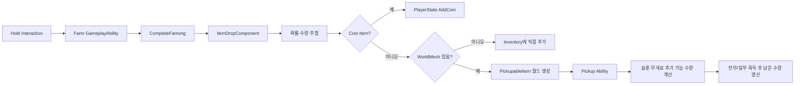
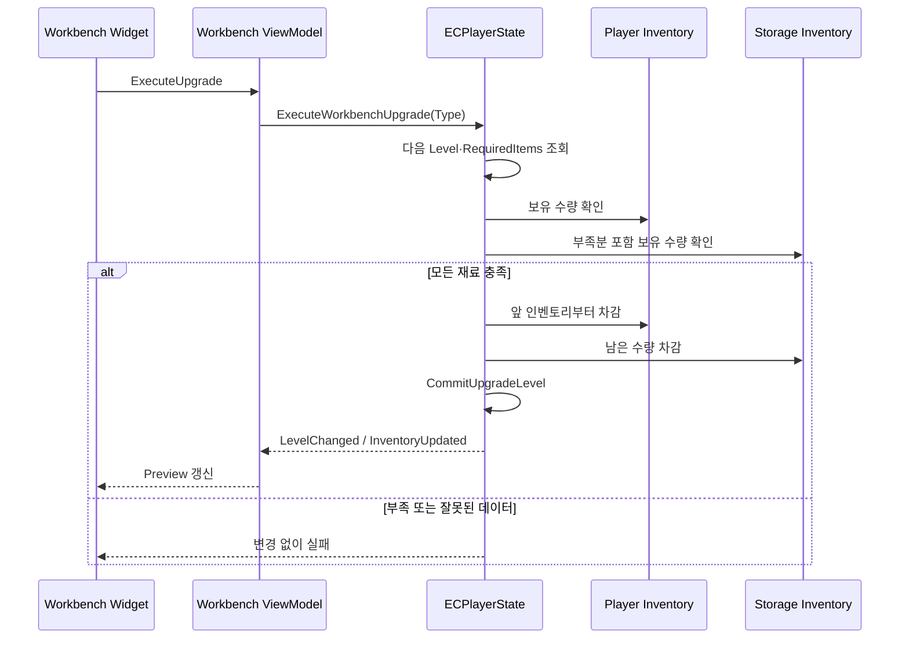

# Inventory, Loot & Upgrade

[← Game Flow](GameFlow.md) · [README](../README.md)

## 검증 기준

Inventory Manager, Pickup, Drop, Farming, Workbench 강화의 C++ 구현을 기준으로 작성했습니다. Item·Drop·Farming DataTable, InventoryItemDefinition Blueprint, WorkbenchUpgrade DataAsset 인스턴스와 UI Blueprint는 포함되지 않아 실제 값과 화면 연결은 검증되지 않았습니다.

## 1. 구현 목적과 요구사항

- 아이템 스택, 슬롯 수, 무게 제한을 함께 검사하고 추가 가능한 수량을 계산한다.
- 플레이어 인벤토리와 보관함 사이에서 전체·부분 이동을 지원한다.
- 여러 강화 재료를 먼저 검증하고, 모두 충족될 때만 수량 감소와 레벨 변경을 한 흐름으로 처리한다.
- 드롭 테이블 결과를 코인, 즉시 인벤토리 지급, 월드 픽업으로 구분한다.
- 인벤토리가 일부만 수용할 수 있으면 가능한 만큼 획득하고 나머지는 월드에 남긴다.
- 작업대 UI가 현재 단계, 다음 수치, 필요 재료, 실행 가능 여부를 ViewModel로 표시한다.

## 2. 핵심 클래스와 책임

| 클래스 | 책임 | 코드 |
|---|---|---|
| `UECInventoryManagerComponent` / `FInventoryList` | 스택 분할·병합, 20개 슬롯, 무게, 이동, 제거, 단일·복수 인벤토리 재료 트랜잭션 | [ECInventoryManagerComponent.h](../EmptyCity/Inventory/ECInventoryManagerComponent.h), [cpp](../EmptyCity/Inventory/ECInventoryManagerComponent.cpp) |
| `UECInventoryItemDefinition` / `UECInventoryItemInstance` | Item Definition과 런타임 Instance, Fragment 기반 확장 | [ECInventoryItemDefinition.h](../EmptyCity/Inventory/ECInventoryItemDefinition.h), [ECInventoryItemInstance.h](../EmptyCity/Inventory/ECInventoryItemInstance.h) |
| `UPickupableStatics` | Actor/Component에서 Pickupable 검색, 부분 획득, 남은 Pickup 갱신 | [IPickupable.h](../EmptyCity/Inventory/IPickupable.h), [cpp](../EmptyCity/Inventory/IPickupable.cpp) |
| `AECPickupableItem` | 월드 Mesh와 Pickup Inventory를 가진 상호작용 Actor | [ECPickupableItem.h](../EmptyCity/Item/ECPickupableItem.h), [cpp](../EmptyCity/Item/ECPickupableItem.cpp) |
| `UECGameplayAbility_PickupItem` | 상호작용 Payload의 대상 획득, 완료 시 Actor 제거, 무게 초과 피드백 | [ECGameplayAbility_PickupItem.h](../EmptyCity/Item/ECGameplayAbility_PickupItem.h), [cpp](../EmptyCity/Item/ECGameplayAbility_PickupItem.cpp) |
| `UECItemDropComponent` | 확률·수량 추첨, 코인·즉시 획득·월드 드롭 분기, 지면 배치 | [ECItemDropComponent.h](../EmptyCity/Item/ECItemDropComponent.h), [cpp](../EmptyCity/Item/ECItemDropComponent.cpp) |
| `AECFarmingResourceActor` | Hold 상호작용 옵션, Farm Ability 연결, 완료 시 드롭 후 제거 | [ECFarmingResourceActor.h](../EmptyCity/Actor/Farming/ECFarmingResourceActor.h), [cpp](../EmptyCity/Actor/Farming/ECFarmingResourceActor.cpp) |
| `UECWorkbenchUpgradeDataAsset` | 강화 타입별 연속 Level, 수치, 재료 정의와 Editor Validation | [ECWorkbenchUpgradeDataAsset.h](../EmptyCity/Data/Workbench/ECWorkbenchUpgradeDataAsset.h), [cpp](../EmptyCity/Data/Workbench/ECWorkbenchUpgradeDataAsset.cpp) |
| `AECPlayerState` | 강화 레벨, 가방+보관함 재료 결제, 강화 값 적용, 저장·복원 | [ECPlayerState.h](../EmptyCity/Character/Player/State/ECPlayerState.h), [cpp](../EmptyCity/Character/Player/State/ECPlayerState.cpp) |
| Workbench ViewModel | 현재/다음 수치·필요 재료·실행 가능 상태 계산과 UI 갱신 | [Stat](../EmptyCity/UI/ViewModel/WorkbenchStatUpgradeViewModel.cpp), [Tool](../EmptyCity/UI/ViewModel/WorkbenchToolUpgradeViewModel.cpp), [Weapon](../EmptyCity/UI/ViewModel/WorkbenchWeaponUpgradeViewModel.cpp) |

## 3. 호출·이벤트 흐름

### 파밍에서 픽업까지

### 작업대 강화 트랜잭션

## 4. 기술적 설계와 구현 방식

### 스택·슬롯·무게를 함께 계산

`FInventoryList::AddEntry`는 같은 Item Definition의 기존 스택을 먼저 채운 뒤 남은 수량을 새 슬롯으로 분할합니다. `GetMaxAddableItemCount`는 기존 스택의 빈 공간, 새 슬롯 용량, 아이템 단위 무게와 최대 무게를 함께 계산합니다. 현재 최대 슬롯 수는 C++ 상수 20입니다.

영구 플레이어 아이템은 Pawn 재생성에 따른 중복 지급을 막고 제거·재료 소모 대상에서 제외합니다. Tool과 Weapon 무게는 PlayerState의 작업대 강화 값을 반영할 수 있습니다.

### 이동과 부분 수용

인벤토리 간 이동은 대상이 수용할 수 있는 최대 수량을 검사합니다. 전체 수량이 들어가지 않으면 이진 탐색으로 가능한 부분 수량을 찾는 경로가 있습니다. Pickup도 같은 용량 계산을 사용해 일부만 추가하고 남은 `FInventoryPickup`을 월드 Actor에 다시 설정합니다. 아무것도 들어가지 않고 무게가 원인이면 별도 결과로 사운드와 경고 알림을 냅니다.

### 재료 소모 트랜잭션

요구 재료 배열에서 같은 Item Definition을 합산하고 잘못된 항목·정수 범위 초과를 먼저 거부합니다. 모든 수량을 사전 검사한 뒤 실패 가능한 외부 호출 없이 엔트리 수량을 줄이고, Commit Callback으로 강화 레벨을 변경한 후 마지막에 갱신 이벤트를 보냅니다. 재진입 Guard가 중첩 트랜잭션을 막습니다.

복수 인벤토리 경로는 플레이어 가방을 먼저, 같은 월드의 Storage 인벤토리를 다음 순서로 사용합니다. 완전한 데이터베이스 트랜잭션은 아니지만 현재 단일 스레드 게임플레이 흐름에서 “검사 후 일괄 적용” 경계를 코드로 명시합니다.

### 드롭 배치

각 Drop Entry의 확률과 수량을 독립적으로 계산합니다. Coin은 PlayerState에 직접 더하고, WorldMesh가 없는 항목은 인벤토리에 직접 추가합니다. Mesh가 있는 항목은 소유 Actor 아래에서 유효한 정적 지면을 찾고 원형으로 분산합니다. 아이템 수와 최소 간격에 따라 배치 반경을 확장하며 Mesh Bounds와 Scale로 바닥 높이를 보정합니다.

### 강화 데이터와 UI

Upgrade DataAsset은 최대 체력, 최대 스태미나, 최대 가방 무게, 도끼, 곡괭이, 무기 타입의 Level·Value·RequiredItems를 정의합니다. Editor Validation은 타입 중복, Level 연속성, ValueId 중복, 재료 정의·수량을 검사합니다. ViewModel은 PlayerState와 Inventory Delegate를 구독해 현재·다음 값을 다시 계산합니다.

## 5. 코드 링크와 커밋 근거

### 주요 코드

- [ECInventoryManagerComponent.cpp](../EmptyCity/Inventory/ECInventoryManagerComponent.cpp)
- [IPickupable.cpp](../EmptyCity/Inventory/IPickupable.cpp)
- [ECItemDropComponent.cpp](../EmptyCity/Item/ECItemDropComponent.cpp)
- [ECPickupableItem.cpp](../EmptyCity/Item/ECPickupableItem.cpp)
- [ECGameplayAbility_PickupItem.cpp](../EmptyCity/Item/ECGameplayAbility_PickupItem.cpp)
- [ECFarmingResourceActor.cpp](../EmptyCity/Actor/Farming/ECFarmingResourceActor.cpp)
- [ECWorkbenchUpgradeDataAsset.cpp](../EmptyCity/Data/Workbench/ECWorkbenchUpgradeDataAsset.cpp)
- [ECPlayerState.cpp](../EmptyCity/Character/Player/State/ECPlayerState.cpp)
- [InventoryInteractionViewModel.cpp](../EmptyCity/UI/ViewModel/InventoryInteractionViewModel.cpp)

### 현재 포트폴리오 저장소 스냅샷

- [`fd3ded4` — 2026-07-03 코드 스냅샷](https://github.com/Fsbsnw/EmptyCity/commit/fd3ded4a1cbdeef1fe6ac18e3b137b8dedecfd45)
- [`5de26c8` — 2026-07-15 코드 스냅샷](https://github.com/Fsbsnw/EmptyCity/commit/5de26c8bc4b0355f4f1231f724feff8ed8cf9ee4)
- [`df17ff3` — 2026-08-31 코드 스냅샷](https://github.com/Fsbsnw/EmptyCity/commit/df17ff371bd2c53fff6d3cd991eb4414187c2116)
- [`20de598` — 2026-08-31 코드 수정 스냅샷](https://github.com/Fsbsnw/EmptyCity/commit/20de5987be833d1f72d26b0646a68fb2b436695b)
- [`06a7c55` — 2026-10-22 최종 코드 스냅샷](https://github.com/Fsbsnw/EmptyCity/commit/06a7c55f5e730dd910af7156541670a4addce4e2)

현재 이력은 기능별 원본 커밋이 아니라 코드 업로드 스냅샷입니다. 초기 인벤토리와 이후 확장의 개발 순서를 이 저장소만으로 단정하지 않습니다.

## 6. 기여 구분

| 범위 | 원본 로컬 Git 메타데이터와 코드상 구분 |
|---|---|
| Item Definition·Instance·여러 Fragment | `meo-young` 변경이 집중된 팀 기반. Lyra 계열 구조와 주석도 확인됨 |
| 초기 Pickup/UseItem 및 Inventory Manager 일부 | `meo-young`와 `Fsbsnw` 변경이 함께 남은 공동 범위 |
| 스택·무게·부분 이동, 드롭 배치, UI/ViewModel, 작업대 강화 연동 | 현재 파일에는 `Fsbsnw` 변경이 많이 남아 있으나 직접 수작업/AI 보조 여부는 별도 확인 필요 |
| `IPickupable` | Epic Games 저작권 표기가 있는 외부 기반 범위로 독자 구현이라 표현하지 않음 |

따라서 “초기 인벤토리·아이템 구조를 팀 기반으로 사용하고, 파밍·드롭·무게·보관함·강화 흐름을 연결·확장한 범위”로 설명하는 것이 안전합니다.

## 7. 구현 결과와 기술적 한계

### 코드로 확인되는 결과

- 스택, 슬롯, 무게를 같은 수용량 계산에 반영합니다.
- Transfer와 Pickup이 대상 용량에 맞춰 부분 수량을 처리합니다.
- 강화 재료를 여러 인벤토리에서 사전 검사한 뒤 한 번의 Commit 경로로 적용합니다.
- 드롭을 화폐·직접 지급·월드 픽업으로 구분하고 지면에 간격을 두어 배치합니다.
- DataAsset Editor Validation과 ViewModel 갱신 경로가 존재합니다.

### 한계와 확인 필요 사항

- 실제 Item/Drop/Farming/Upgrade 데이터가 없어 밸런스와 콘텐츠 완성도를 검증할 수 없습니다.
- Inventory List 자체의 네트워크 복제 선언은 현재 코드에서 확인되지 않으며, 멀티플레이 동기화는 검증하지 않았습니다.
- 여러 Storage 중 어떤 순서로 재료를 쓰는지는 월드 Actor 순회 결과에 의존할 수 있습니다.
- 강화 Commit Callback은 실패하지 않는다는 계약에 의존하며, 일반적인 Rollback 시스템은 아닙니다.
- 월드 드롭 실패 시 재시도·영속화 정책과 Save 연동은 확인되지 않았습니다.
- 최대 20 슬롯이 C++ 상수라 데이터 기반 조정은 제한적입니다.

