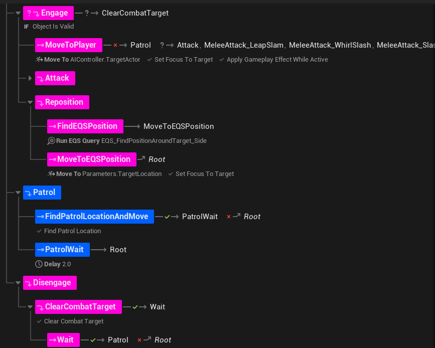
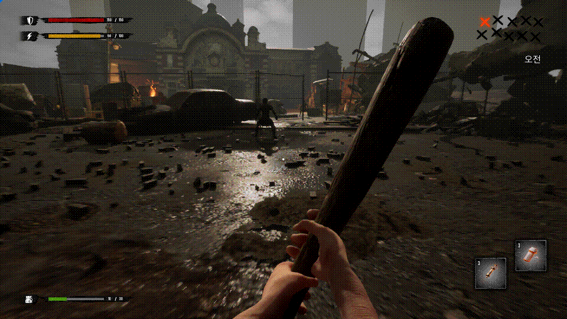

# StateTree 기반 적 AI

[← README](../README.md)

적 감지와 타깃 관리는 AIController, 행동 선택은 StateTree, 공격 실행은 GAS Ability로 나누었습니다.

> ### 스테이트 트리 그래프
> 

## 동작 흐름

`AI Perception → EnemyAIController(대상·교전 이벤트) → StateTree → ActivateAbility Task → GAS`

- Controller가 시야·타깃 및 피격을 통한 교전 진입을 처리합니다.
- 재사용 Task·Condition·Evaluator로 사거리, 쿨다운, GameplayTag와 행동을 연결합니다.
- Ability가 활성인 동안 Task가 Running을 유지해 전투 동작과 상태 종료 시점을 연동합니다.
- 시야 상실 유예, NavMesh 순찰 지점 탐색, 거리 기반 StateTree 중단 등 실제 월드에서 필요한 예외를 처리합니다.

> ### 감지 -> 추적 -> 공격
> 

## 주요 코드

- [ECEnemyAIController.cpp](../EmptyCity/Character/Enemy/AI/ECEnemyAIController.cpp)
- [STTask_ActivateAbility.cpp](../EmptyCity/Character/Enemy/AI/Statetree/STTask/STTask_ActivateAbility.cpp)
- [STTask_FindPatrolLocation.cpp](../EmptyCity/Character/Enemy/AI/Statetree/STTask/STTask_FindPatrolLocation.cpp)
- [STEvaluator_TagStatus.cpp](../EmptyCity/Character/Enemy/AI/Statetree/STEvaluator/STEvaluator_TagStatus.cpp)
