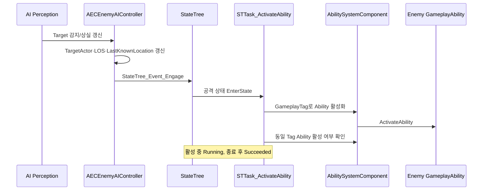
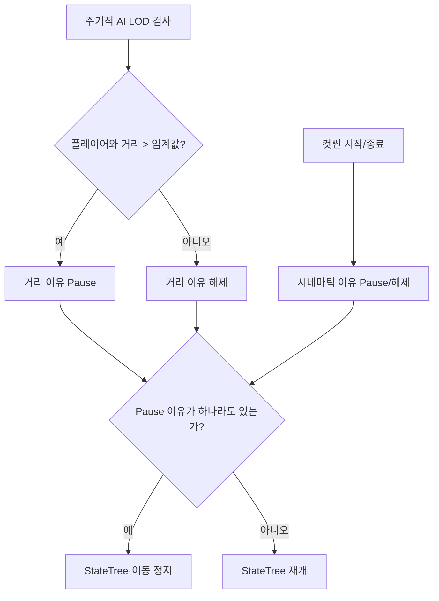

# StateTree Enemy AI

[← UI Framework](UI_Framework.md) · [README](../README.md) · [GAS Combat →](GAS_Combat.md)

## 검증 기준

AIController와 StateTree Task·Condition·Evaluator의 C++ 구현은 확인했습니다. 실제 StateTree 에셋은 저장소에 없으므로 상태 계층, 전이 우선순위, 바인딩 값, 적 종류별 설정은 검증되지 않았습니다.

## 1. 구현 목적과 요구사항

- 감지, 전투 대상, 마지막 확인 위치를 AIController가 관리하고 행동 선택은 StateTree에 맡긴다.
- 순찰·회전·포커스·Ability 실행 같은 공통 행동을 재사용 가능한 C++ 노드로 제공한다.
- GAS Ability의 활성 상태와 쿨다운·상태 Tag를 StateTree 판단에 연결한다.
- 패링·사망·컷씬처럼 외부 시스템이 AI 행동을 중단할 때 이동과 StateTree를 안전하게 정리한다.
- 플레이어와 멀어진 적의 로직을 일시 정지할 수 있는 거리 기반 LOD 경로를 둔다.

## 2. 핵심 클래스와 책임

| 클래스 | 책임 | 코드 |
|---|---|---|
| `AECEnemyAIController` | AI Perception, TargetActor, LOS/마지막 위치, StateTree 시작·정지, 거리·컷씬 일시 정지, 사망 정리 | [ECEnemyAIController.h](../EmptyCity/Character/Enemy/AI/ECEnemyAIController.h), [cpp](../EmptyCity/Character/Enemy/AI/ECEnemyAIController.cpp) |
| `UECEnemyStateTreeAIComponent` | Controller에 내장된 StateTree 실행 컴포넌트 | [ECEnemyAIController.h](../EmptyCity/Character/Enemy/AI/ECEnemyAIController.h) |
| `FSTTask_ActivateAbility` | Tag로 Ability를 활성화하고 해당 Ability가 활성 상태인 동안 `Running` 유지 | [STTask_ActivateAbility.h](../EmptyCity/Character/Enemy/AI/Statetree/STTask/STTask_ActivateAbility.h), [cpp](../EmptyCity/Character/Enemy/AI/Statetree/STTask/STTask_ActivateAbility.cpp) |
| `FSTTask_ApplyGEWhileActive` | State 진입 중 GameplayEffect 적용, 실제 종료 시 제거 | [STTask_ApplyGEWhileActive.h](../EmptyCity/Character/Enemy/AI/Statetree/STTask/STTask_ApplyGEWhileActive.h), [cpp](../EmptyCity/Character/Enemy/AI/Statetree/STTask/STTask_ApplyGEWhileActive.cpp) |
| `FSTTask_FindPatrolLocation` | NavMesh 투영, 도달 가능한 랜덤 순찰점, 정체·최대 탐색 시간 방어 | [STTask_FindPatrolLocation.h](../EmptyCity/Character/Enemy/AI/Statetree/STTask/STTask_FindPatrolLocation.h), [cpp](../EmptyCity/Character/Enemy/AI/Statetree/STTask/STTask_FindPatrolLocation.cpp) |
| `FSTCondition_CheckCooldown` | ASC의 쿨다운 GameplayTag로 조건 판정 | [STCondition_CheckCooldown.cpp](../EmptyCity/Character/Enemy/AI/Statetree/STCondition/STCondition_CheckCooldown.cpp) |
| `FSTCondition_TargetInRange` | 두 Actor의 거리를 기준으로 상태 조건 판정 | [STCondition_TargetInRange.cpp](../EmptyCity/Character/Enemy/AI/Statetree/STCondition/STCondition_TargetInRange.cpp) |
| `FSTEvaluator_TagStatus` | GameplayTag 보유 상태를 StateTree 데이터로 반영하고 변경 이벤트 전송 | [STEvaluator_TagStatus.cpp](../EmptyCity/Character/Enemy/AI/Statetree/STEvaluator/STEvaluator_TagStatus.cpp) |

## 3. 호출·이벤트 흐름

### 감지에서 공격 실행까지

### 일시 정지 이유의 분리

## 4. 기술적 설계와 구현 방식

### Controller가 센서와 런타임 상태를 소유

`OnPossess`에서 적 Character가 가진 `UStateTree*`를 StateTree 컴포넌트에 지정하고 로직을 시작합니다. AI Perception 콜백은 시야 확보 여부와 마지막 확인 위치를 갱신하고, 감지 시 교전 이벤트를 StateTree에 보냅니다. 시야 상실은 즉시 대상 제거가 아니라 유예 타이머를 거치며, 액션 Montage 중에는 대상 해제를 미룹니다.

### StateTree 노드와 GAS의 경계

StateTree는 어떤 행동을 실행할지 결정하고 `STTask_ActivateAbility`는 Ability Tag로 GAS에 실행을 요청합니다. 실제 Montage, Trace, 데미지, 패링은 Gameplay Ability 계층에서 처리합니다. Task는 Ability가 끝날 때까지 `Running`을 유지하므로 애니메이션 반응과 StateTree 전환의 동기화 지점이 됩니다.

`STTask_ApplyGEWhileActive`는 상태가 실제로 종료될 때 GameplayEffect를 제거합니다. 지속 전이 중의 진입·이탈을 구분해 불필요한 효과 재적용을 피하려는 분기가 코드에 존재합니다.

### 순찰점 탐색의 방어 조건

순찰 Task는 중심점을 NavMesh에 투영하고 도달 가능한 랜덤 위치를 찾습니다. 후보 탐색 횟수 외에도 동일 지점에 머무르는 상황과 최대 실행 시간을 검사해 State가 무기한 `Running`에 머무르지 않도록 합니다.

### 거리 LOD와 컷씬 중단

Controller는 기본 2초 간격으로 플레이어와의 거리를 검사하고 기본 3000cm 밖이면 거리 이유로 AI 로직을 일시 정지합니다. 컷씬은 별도의 시네마틱 이유를 사용합니다. 여러 이유를 독립 플래그로 관리하므로 한 이유가 해제되어도 다른 이유가 남아 있으면 재개하지 않습니다.

## 5. 코드 링크와 커밋 근거

### 주요 코드

- [ECEnemyAIController.cpp](../EmptyCity/Character/Enemy/AI/ECEnemyAIController.cpp)
- [STTask_ActivateAbility.cpp](../EmptyCity/Character/Enemy/AI/Statetree/STTask/STTask_ActivateAbility.cpp)
- [STTask_ApplyGEWhileActive.cpp](../EmptyCity/Character/Enemy/AI/Statetree/STTask/STTask_ApplyGEWhileActive.cpp)
- [STTask_FindPatrolLocation.cpp](../EmptyCity/Character/Enemy/AI/Statetree/STTask/STTask_FindPatrolLocation.cpp)
- [STTask_RotateToTarget.cpp](../EmptyCity/Character/Enemy/AI/Statetree/STTask/STTask_RotateToTarget.cpp)
- [STEvaluator_TagStatus.cpp](../EmptyCity/Character/Enemy/AI/Statetree/STEvaluator/STEvaluator_TagStatus.cpp)

### 현재 포트폴리오 저장소 스냅샷

- [`8c42eb5` — 2026-06-10 클래스 스냅샷](https://github.com/Fsbsnw/EmptyCity/commit/8c42eb588f95f9a5514529fd59032e36a58f696c)
- [`df17ff3` — 2026-08-31 코드 스냅샷](https://github.com/Fsbsnw/EmptyCity/commit/df17ff371bd2c53fff6d3cd991eb4414187c2116)
- [`06a7c55` — 2026-10-22 최종 코드 스냅샷](https://github.com/Fsbsnw/EmptyCity/commit/06a7c55f5e730dd910af7156541670a4addce4e2)

현재 저장소만으로는 Behavior Tree에서 StateTree로 전환한 원본 개발 커밋이나 이후 안정화 커밋을 공개 링크로 제시할 수 없습니다. `BTTask`, `BTService`, `BTDecorator` 폴더가 함께 남아 있으므로, 레거시 코드의 실제 런타임 사용 여부도 에셋 없이 완전히 판단할 수 없습니다.

## 6. 기여 구분

- 원본 팀 저장소의 로컬 Git 메타데이터상 현재 AIController와 StateTree 노드 파일에는 `Fsbsnw` 변경이 집중되어 있었습니다.
- 이 정보는 직접 수작업 작성이나 AI 비사용을 의미하지 않습니다. AI가 생성·수정한 범위는 지원자가 별도로 확인해야 합니다.
- GAS 기반 클래스와 AbilitySystemComponent는 팀 공용 기반이며, StateTree 문서에서도 이 기반 전체를 개인 구현으로 표현하지 않습니다.
- StateTree 에셋은 저장소에 없으므로 노드의 실제 배치와 상태 설계에 대한 개인 기여는 검증되지 않았습니다.

## 7. 구현 결과와 기술적 한계

### 코드로 확인되는 결과

- 감지 상태와 행동 선택을 Controller와 StateTree로 나눴습니다.
- GAS Ability 실행 상태를 StateTree Task의 완료 조건으로 사용합니다.
- 순찰, 사거리, 쿨다운, Tag 상태를 재사용 노드로 분리했습니다.
- 거리와 컷씬이라는 서로 다른 정지 이유를 분리해 재개 조건을 관리합니다.
- 사망·UnPossess 시 타이머, 이동, StateTree, 전투 대상을 정리하는 경로가 있습니다.

### 한계와 확인 필요 사항

- StateTree 그래프와 Property Binding이 없어 실제 상태 전이 순서를 검증할 수 없습니다.
- 적 종류별 StateTree, Ability Tag, 거리·쿨다운 값은 확인되지 않았습니다.
- 2초·3000cm 기본값은 코드 기본값일 뿐 실제 에셋/Blueprint에서 덮어썼을 수 있습니다.
- 거리 LOD의 성능 개선 수치나 프로파일링 자료는 저장소에 없습니다.
- 멀티플레이에서의 AI 권한·복제 동작은 이 코드만으로 검증하지 않았습니다.

