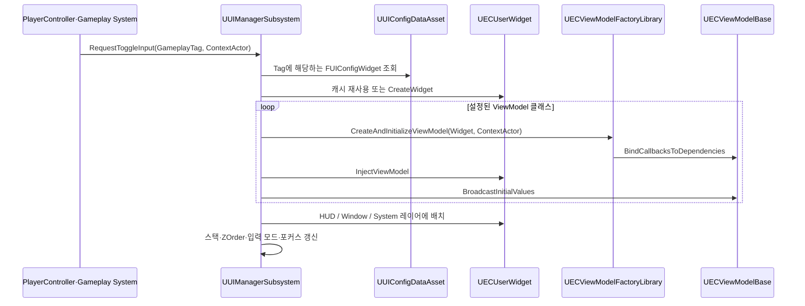
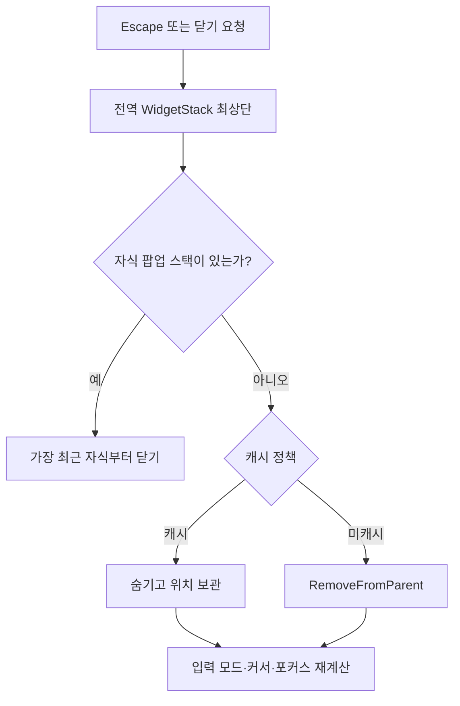

# UI Framework

[← README](../README.md) · [StateTree AI →](StateTree_AI.md)

## 검증 기준

이 문서는 현재 저장소의 C++ 소스를 기준으로 작성했습니다. Blueprint 위젯, `UIConfig` DataAsset 인스턴스, MVVM 에디터 바인딩은 저장소에 없어 내부 구성을 확인하지 못했습니다. 현재 저장소의 커밋은 원본 팀 개발 이력이 아니라 날짜별 스냅샷 이력입니다.

## 1. 구현 목적과 요구사항

- PlayerController와 게임플레이 객체가 구체적인 위젯 클래스를 직접 생성하지 않고 GameplayTag로 화면을 요청한다.
- HUD, 일반 창, 시스템 화면의 표시 계층과 닫기 순서를 한 곳에서 관리한다.
- 동일 화면의 중복 생성, 캐싱, 마우스 커서, 포커스, 입력 모드 전환을 공통 처리한다.
- 위젯이 게임플레이 객체를 직접 탐색하지 않도록 `ContextActor`를 기준으로 ViewModel을 만들고 주입한다.
- 상위 창 안의 상세 팝업은 전역 창보다 먼저 닫히도록 부모·자식 스택을 분리한다.

## 2. 핵심 클래스와 책임

| 클래스 | 책임 | 코드 |
|---|---|---|
| `UUIManagerSubsystem` | GameplayTag 요청 수신, 위젯 생성·재사용, 레이어 배치, 전역 스택, 포커스·입력 모드, Fade 전환 | [UIManagerSubsystem.h](../EmptyCity/UI/Subsystem/UIManagerSubsystem.h), [cpp](../EmptyCity/UI/Subsystem/UIManagerSubsystem.cpp) |
| `UUIConfigDataAsset` / `FUIConfigData` | Tag별 위젯 클래스, ViewModel 목록, 캐시 정책, 마우스, 레이어, 전환 방식을 데이터로 정의 | [UIConfigDataAsset.h](../EmptyCity/Data/UI/UIConfigDataAsset.h), [cpp](../EmptyCity/Data/UI/UIConfigDataAsset.cpp) |
| `UECMainLayoutWidget` | HUD와 Window 컨테이너 제공, UIManager가 위젯을 올릴 루트 역할 | [ECMainLayoutWidget.h](../EmptyCity/UI/Widget/ECMainLayoutWidget.h), [cpp](../EmptyCity/UI/Widget/ECMainLayoutWidget.cpp) |
| `UECUserWidget` | ViewModel 보관, 드래그, 자식 위젯 스택, 닫기 요청 전달, 포커스 보고 | [ECUserWidget.h](../EmptyCity/UI/Widget/ECUserWidget.h), [cpp](../EmptyCity/UI/Widget/ECUserWidget.cpp) |
| `UECViewModelFactoryLibrary` | Widget을 Outer로 ViewModel 생성 후 `ContextActor` 의존성 바인딩 | [ECViewModelFactoryLibrary.h](../EmptyCity/UI/ViewModel/ECViewModelFactoryLibrary.h), [cpp](../EmptyCity/UI/ViewModel/ECViewModelFactoryLibrary.cpp) |
| `UECViewModelBase` | PlayerController, Pawn, PlayerState, ContextActor 참조 캐시와 초기 값 전파 인터페이스 | [ECViewModelBase.h](../EmptyCity/UI/ViewModel/ECViewModelBase.h), [cpp](../EmptyCity/UI/ViewModel/ECViewModelBase.cpp) |
| `UInventoryViewModel` | Inventory 변경 Delegate를 UI 갱신 이벤트로 변환하고 수명 종료 시 해제 | [InventoryViewModel.h](../EmptyCity/UI/ViewModel/InventoryViewModel.h), [cpp](../EmptyCity/UI/ViewModel/InventoryViewModel.cpp) |

## 3. 호출·이벤트 흐름

### 위젯 열기와 ViewModel 주입

### 닫기 우선순위

## 4. 기술적 설계와 구현 방식

### GameplayTag를 UI 식별자로 사용

`FUIConfigData`는 GameplayTag와 `FUIConfigWidget`을 연결합니다. 설정에는 Widget 클래스, 주입할 ViewModel 클래스 배열, 캐시 여부, 마우스 사용 여부, HUD·Window·System 레이어, 전환 방식이 포함됩니다. 호출자는 클래스 대신 Tag와 선택적 `ContextActor`만 전달합니다.

이 구조로 UI 요청부와 화면 클래스의 직접 결합은 줄었지만, 설정 DataAsset 인스턴스가 저장소에 없어 실제 Tag 매핑의 완전성은 검증할 수 없습니다.

### 레이어와 스택의 역할 분리

- `UECMainLayoutWidget`은 HUD Overlay와 Window Canvas를 제공합니다.
- System 레이어는 MainLayout 컨테이너가 아니라 Viewport에 높은 ZOrder로 추가됩니다.
- UIManager의 전역 `WidgetStack`은 최상위 화면 순서를 관리합니다.
- `UECUserWidget`의 자식 스택은 상세 팝업처럼 부모 내부에서 먼저 닫혀야 하는 화면을 관리합니다.
- 활성 창이 있으면 `GameAndUI`, 사망 화면은 `UIOnly`, 스택이 비면 `GameOnly`로 입력 모드를 전환합니다.

### 수명과 ContextActor

ViewModel은 Widget을 Outer로 생성되어 Widget 수명에 귀속됩니다. `ContextActor`는 보관함, 침대처럼 “어떤 대상과 상호작용했는가”를 전달하는 통로입니다. Inventory ViewModel처럼 Delegate를 구독하는 클래스는 `BeginDestroy`에서 연결을 제거합니다.

### Fade 전환 재사용

UIManager는 Fade가 필요한 요청을 연출 완료 후 같은 Toggle 경로로 되돌립니다. 지역 이동도 이 Fade 콜백을 사용하므로 UI 전환과 월드 텔레포트의 화면 노출 시점을 같은 시스템에서 조정합니다. 관련 흐름은 [Game Flow](GameFlow.md)에 이어집니다.

## 5. 코드 링크와 커밋 근거

### 주요 코드

- [UIManagerSubsystem.cpp](../EmptyCity/UI/Subsystem/UIManagerSubsystem.cpp)
- [ECUserWidget.cpp](../EmptyCity/UI/Widget/ECUserWidget.cpp)
- [ECMainLayoutWidget.cpp](../EmptyCity/UI/Widget/ECMainLayoutWidget.cpp)
- [UIConfigDataAsset.h](../EmptyCity/Data/UI/UIConfigDataAsset.h)
- [ECViewModelFactoryLibrary.cpp](../EmptyCity/UI/ViewModel/ECViewModelFactoryLibrary.cpp)
- [InventoryInteractionViewModel.cpp](../EmptyCity/UI/ViewModel/InventoryInteractionViewModel.cpp)
- [TimeViewModel.cpp](../EmptyCity/UI/ViewModel/TimeViewModel.cpp)

### 현재 포트폴리오 저장소에서 확인되는 스냅샷

- [`8c42eb5` — 2026-06-10 클래스 스냅샷](https://github.com/Fsbsnw/EmptyCity/commit/8c42eb588f95f9a5514529fd59032e36a58f696c)
- [`5de26c8` — 2026-07-15 Indicator / Message 추가 스냅샷](https://github.com/Fsbsnw/EmptyCity/commit/5de26c8bc4b0355f4f1231f724feff8ed8cf9ee4)
- [`df17ff3` — 2026-08-31 코드 스냅샷](https://github.com/Fsbsnw/EmptyCity/commit/df17ff371bd2c53fff6d3cd991eb4414187c2116)
- [`20de598` — 2026-08-31 코드 수정 스냅샷](https://github.com/Fsbsnw/EmptyCity/commit/20de5987be833d1f72d26b0646a68fb2b436695b)
- [`06a7c55` — 2026-10-22 최종 코드 스냅샷](https://github.com/Fsbsnw/EmptyCity/commit/06a7c55f5e730dd910af7156541670a4addce4e2)

이 커밋들은 코드가 각 스냅샷에 존재했음을 보여줍니다. 원본 팀 저장소의 세부 변경 커밋은 현재 저장소에 이어지지 않았으므로, 기능별 개발 순서나 최초 작성자를 이 이력만으로 판단할 수 없습니다.

## 6. 기여 구분

- 원본 팀 저장소의 로컬 Git 메타데이터를 대조했을 때 이 문서의 UIManager, MainLayout, ViewModel 계열 현재 파일에는 `Fsbsnw` 변경이 집중되어 있었습니다.
- 이것은 Git 작성자·현재 줄의 귀속 정보이며, 직접 수작업 작성 여부나 AI 생성·수정 범위를 증명하지 않습니다. 지원자는 공개 전 해당 범위를 직접 확인해야 합니다.
- Indicator 계열 파일에는 Epic Games 저작권 표기가 있고, 기존 README도 Lyra 구조를 프로젝트 범위에 맞게 이식했다고 설명합니다. 이를 독자 구현으로 표현하지 않습니다.
- Gameplay Message와 Notification 역시 Lyra 구조의 영향을 받은 범위와 프로젝트 연동 범위를 분리해 설명해야 합니다.

## 7. 구현 결과와 기술적 한계

### 코드로 확인되는 결과

- Tag 기반 공통 진입점에서 위젯 수명, 레이어, 포커스, 입력 모드를 관리합니다.
- 전역 화면과 부모 내부 팝업의 닫기 순서를 별도 스택으로 처리합니다.
- ContextActor와 ViewModel 주입 경로로 상호작용 대상을 화면에 전달합니다.
- Inventory, 시간, 작업대 등 여러 ViewModel이 Delegate를 UI 갱신으로 변환합니다.

### 한계와 확인 필요 사항

- `UUIManagerSubsystem`은 `ULocalPlayerSubsystem`이지만 일부 경로가 `GetFirstPlayerController()`에 의존합니다. 다중 로컬 플레이어·분할 화면 동작은 확인되지 않았습니다.
- `FUIConfigWidget`의 `IMCPriority` 필드는 현재 UI C++ 경로에서 사용하는 곳을 찾지 못했습니다.
- Blueprint 위젯의 실제 계층, 애니메이션, MVVM 바인딩, UIConfig 값이 없어 화면 전체 동작을 재현할 수 없습니다.
- 자동화 테스트나 UI 회귀 테스트 코드는 저장소에서 확인하지 못했습니다.
- 외부 호스팅 스크린샷은 실행 증거를 보조하지만 현재 소스와 동일 빌드인지 독립 검증할 수 없습니다.

