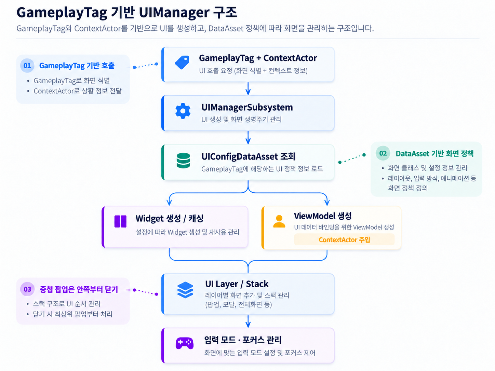

# GameplayTag UIManager · MVVM

[← README](../README.md)

개별 게임플레이 코드에서 위젯을 직접 생성하는 대신, GameplayTag를 공통 식별자로 사용해 UI 요청과 화면 관리 정책을 분리했습니다.

## 구현 방식

`GameplayTag + ContextActor → UUIManagerSubsystem → UIConfig → Widget/VM → HUD·Window·System`

- **UIConfig:** 태그마다 위젯 클래스·레이어·캐싱·커서 정책과 ViewModel 목록을 정의합니다.
- **화면 계층:** 전역 창 스택과 창 내부 팝업 스택을 구분해 ESC 입력 시 내부 팝업을 먼저 닫습니다.
- **입력과 포커스:** 활성 창에 따라 입력 모드와 커서·포커스를 공통 관리합니다.
- **MVVM:** 플레이어 상태와 ContextActor를 ViewModel에 주입하고 변경 이벤트로 UI를 갱신합니다.

> 

## 주요 코드

- [UIManagerSubsystem.cpp](../EmptyCity/UI/Subsystem/UIManagerSubsystem.cpp)
- [UIConfigDataAsset.h](../EmptyCity/Data/UI/UIConfigDataAsset.h)
- [ECUserWidget.cpp](../EmptyCity/UI/Widget/ECUserWidget.cpp)
- [ECViewModelFactoryLibrary.cpp](../EmptyCity/UI/ViewModel/ECViewModelFactoryLibrary.cpp)
