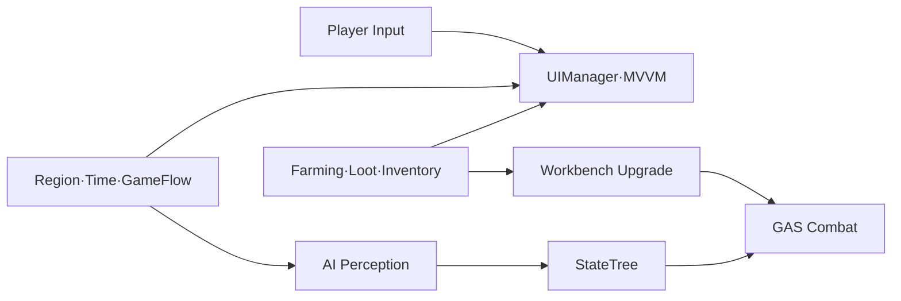
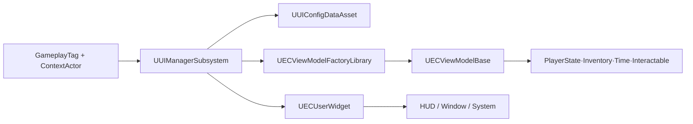
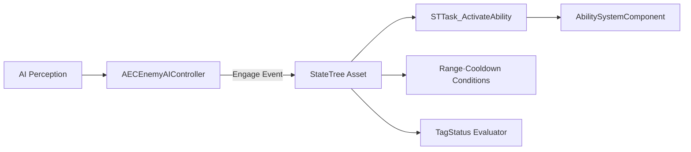
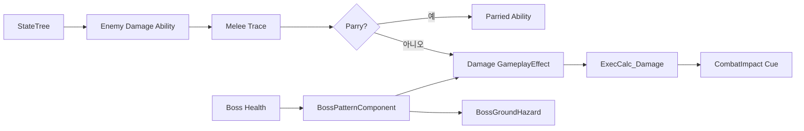
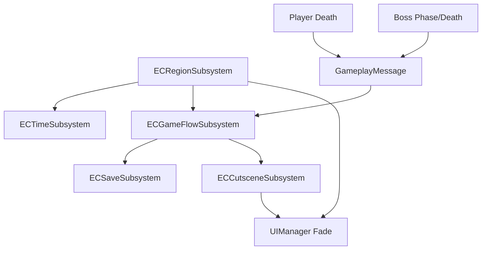
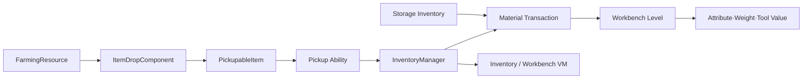
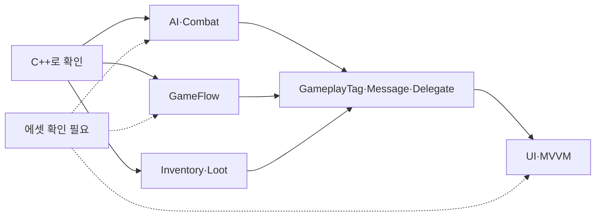

# EmptyCity PDF Portfolio Content — Pages 2–8

[← README](../README.md)

## 사용 범위

이 자료는 10페이지 포트폴리오 중 **EmptyCity에 해당하는 2~8페이지**만 다룹니다. 1페이지 표지와 9~10페이지 Project SIH 내용은 다른 저장소에서 준비합니다.

문구는 현재 저장소의 C++로 확인되는 사실을 기준으로 작성했습니다. Blueprint, StateTree, GameplayEffect, DataAsset, Level Sequence 내부는 검증되지 않았으므로 PDF 캡처를 추가할 때 실제 에디터 설정과 다시 대조해야 합니다.

---

## 2페이지 — EmptyCity 프로젝트 소개

### 강조할 핵심 메시지

> 생존·탐험 플레이 루프를 지탱하는 AI, 전투, UI, 지역·시간, 파밍 시스템의 C++ 연결 구조를 다룬 팀 프로젝트입니다.

### 핵심 구현 내용

- AI Perception → StateTree → GAS Ability로 이어지는 적 행동·전투 흐름
- GameplayTag 기반 UIManager와 ContextActor 기반 ViewModel 주입
- 지역 이동·시간 진행·체크포인트·사망·컷씬을 조정하는 Subsystem 구조
- 인벤토리·월드 드롭·파밍·작업대 강화로 이어지는 획득·성장 루프

### 추천 시스템 구조도

구조도에 넣을 실제 클래스:

- `AECEnemyAIController`, `FSTTask_ActivateAbility`
- `UECEnemyDamageAbility_Melee`, `UEnemyMeleeTraceComponent`
- `UUIManagerSubsystem`, `UECViewModelBase`
- `UECGameFlowSubsystem`, `UECRegionSubsystem`, `UECTimeSubsystem`
- `UECInventoryManagerComponent`, `UECItemDropComponent`

### 추천 캡처

- 플레이 화면 1장: 탐험·전투·HUD가 함께 보이는 장면
- Unreal Editor 전체 화면 1장: 프로젝트 구조 또는 대표 Map
- 작은 보조 캡처: Inventory, Map, Boss 중 서로 다른 기능 2개
- 공개 전 다른 팀원 제작 에셋과 UI 이미지 사용 허가 확인

### GitHub 상세 문서

- [README 기술 개요](../README.md)
- [StateTree AI](../Docs/StateTree_AI.md)
- [UI Framework](../Docs/UI_Framework.md)

### 면접 예상 질문

- 팀 프로젝트에서 본인이 확인 가능한 기여 범위와 팀 공용 기반은 어디까지인가?
- StateTree, GAS, UIManager를 각각 어떤 책임으로 나눴는가?
- 저장소에 에셋이 없을 때 구현 사실을 어떤 방식으로 검증했는가?

### 주의 문구

하단 각주에 “포트폴리오 저장소는 원본 팀 Git 이력이 아닌 코드 스냅샷이며, 게임 에셋은 제외됨”을 짧게 넣는 것을 권장합니다.

---

## 3페이지 — GameplayTag 기반 UIManager와 MVVM

### 강조할 핵심 메시지

> UI 생성·레이어·닫기 순서·입력 모드를 UIManager로 모으고, 화면 데이터는 ContextActor 기반 ViewModel로 분리했습니다.

### 핵심 구현 내용

- GameplayTag → UIConfig → Widget 생성·캐싱으로 호출부와 위젯 클래스 결합 축소
- HUD·Window·System 계층 및 전역/자식 스택으로 표시·닫기 순서 관리
- 활성 화면에 따라 `GameOnly`, `GameAndUI`, `UIOnly` 입력 모드 전환
- Widget을 Outer로 생성한 ViewModel에 ContextActor를 주입하고 Delegate 기반으로 갱신

### 추천 시스템 구조도

구조도에 넣을 실제 클래스:

- `UUIManagerSubsystem`
- `UUIConfigDataAsset`, `FUIConfigWidget`
- `UECMainLayoutWidget`, `UECUserWidget`
- `UECViewModelFactoryLibrary`, `UECViewModelBase`
- `UInventoryViewModel`, `UInventoryInteractionViewModel`

### 추천 캡처

- UIConfig DataAsset의 Tag·Widget·ViewModel 설정 화면
- MainLayout Blueprint에서 HUD/Window Layer가 보이는 화면
- 전역 창 위에 자식 팝업이 열린 Inventory/Storage 화면
- 입력 모드 변화가 보이도록 게임 화면과 메뉴 화면을 나란히 배치

### GitHub 상세 문서

- [UI Framework](../Docs/UI_Framework.md)

### 면접 예상 질문

- CommonUI가 아닌 자체 UIManager를 둔 이유와 교체 비용은?
- 위젯 캐시 시 Delegate와 ViewModel 수명을 어떻게 안전하게 관리했는가?
- 전역 스택과 자식 스택을 하나로 합치지 않은 이유는?
- `ULocalPlayerSubsystem`인데 첫 PlayerController를 쓰는 경로의 문제는?

---

## 4페이지 — StateTree 기반 적 AI

### 강조할 핵심 메시지

> 감지·대상 관리는 AIController, 행동 선택은 StateTree, 실제 공격은 GAS로 나눠 상태 판단과 실행을 연결했습니다.

### 핵심 구현 내용

- AI Perception으로 TargetActor, LOS, 마지막 확인 위치를 갱신하고 교전 이벤트 전송
- Ability 활성 상태, 쿨다운, 사거리, GameplayTag를 재사용 Task·Condition·Evaluator로 제공
- 순찰점 NavMesh 투영, 정체·최대 시간 방어로 무한 `Running` 가능성 축소
- 거리와 컷씬을 별도 Pause 이유로 관리해 StateTree·이동 정지/재개

### 추천 시스템 구조도

구조도에 넣을 실제 클래스:

- `AECEnemyAIController`, `UECEnemyStateTreeAIComponent`
- `FSTTask_ActivateAbility`, `FSTTask_FindPatrolLocation`
- `FSTTask_ApplyGEWhileActive`
- `FSTCondition_TargetInRange`, `FSTCondition_CheckCooldown`
- `FSTEvaluator_TagStatus`

### 추천 캡처

- StateTree 전체 그래프: Patrol·Chase·Attack 상태와 전이가 한 화면에 보이게
- `STTask_ActivateAbility`가 배치된 공격 State의 Details 패널
- AI Debug 화면: 시야, TargetActor, NavMesh가 보이는 장면
- 거리 LOD 전후 `stat` 또는 디버그 로그 캡처는 실제 측정값이 있을 때만 사용

### GitHub 상세 문서

- [StateTree AI](../Docs/StateTree_AI.md)
- [GAS Combat](../Docs/GAS_Combat.md)

### 면접 예상 질문

- Behavior Tree 대신 StateTree를 사용한 이유와 남아 있는 BT 코드는 무엇인가?
- Ability가 끝날 때까지 StateTree Task를 `Running`으로 유지한 이유는?
- 감지 상실 즉시 Target을 지우지 않고 유예하는 이유는?
- 거리 LOD의 임계값과 검사 주기를 어떻게 검증했는가?

### 검증 메모

StateTree 그래프 캡처를 넣기 전 C++ 노드 이름·Property Binding과 현재 에셋 구성을 직접 대조해야 합니다.

---

## 5페이지 — GAS 전투와 보스 패턴

### 강조할 핵심 메시지

> 공격 실행·판정·수치 계산·피드백을 GAS 파이프라인으로 나누고, 보스 패턴과 컷씬 전환을 같은 이벤트 흐름에 연결했습니다.

### 핵심 구현 내용

- Montage 유효 구간의 소켓 Sphere Sweep과 공격별 중복 적중 방지
- 패링 Window와 방향 내적으로 패링/데미지 분기, 반응 종료까지 StateTree 동기화
- EffectContext·GameplayTag·SetByCaller → ExecCalc → GameplayCue 흐름
- 보스 체력 임계 장판, 서버 판정·Multicast 연출, Sprint→LeapSlam 단계 관리

### 추천 시스템 구조도

구조도에 넣을 실제 클래스:

- `UECEnemyDamageAbility_Melee`, `UEnemyMeleeTraceComponent`
- `UECExecCalc_Damage`, `UECGameplayCue_CombatImpact`
- `UECGameplayAbility_Parried`
- `AECEnemyBoss`, `UECBossPatternComponent`, `AECBossGroundHazard`
- `UECGameplayAbility_BossSprintLeapSlam`

### 추천 캡처

- 패링 직전/성공/반응의 3프레임 시퀀스
- Montage Notify 구간과 Trace Debug Sphere가 함께 보이는 에디터 화면
- 75% 경고 장판 준비와 50% 순차 폭발 게임 화면
- Sprint→LeapSlam의 시작·도약·착지 3단계

### GitHub 상세 문서

- [GAS Combat](../Docs/GAS_Combat.md)
- [Boss Battle](../Docs/Boss_Battle.md)

### 면접 예상 질문

- 왜 Trace를 Ability가 아니라 Component로 분리했는가?
- 패링 직후 공격 Ability를 바로 끝내지 않은 이유는?
- SetByCaller와 GameplayTag를 어떻게 사용했고 잘못된 Tag는 어떻게 방어하는가?
- 장판의 서버 판정과 클라이언트 연출을 왜 나눴는가?
- NavMesh 이탈이나 Montage 취소 시 보스 이동 상태를 어떻게 복구하는가?

### 기여 표기

“GAS 전체 구현”이 아니라 “팀 GAS 기반 위 적 공격·패링·판정·피드백과 보스 패턴의 확장·연동”으로 표기합니다. `ECExecCalc_Damage`와 GAS 기반에는 공동·타 팀원 기여가 있습니다.

---

## 6페이지 — 지역·시간·사망·컷씬 GameFlow

### 강조할 핵심 메시지

> 여러 Subsystem이 소유한 상태를 GameFlow가 이벤트로 조정해 이동, 시간, 저장, 사망 복귀, 컷씬을 하나의 플레이 흐름으로 연결했습니다.

### 핵심 구현 내용

- Fade-out 안에서 텔레포트·지역 확정·최초 방문 컷씬을 처리하고 Fade-in 후 입력 복구
- 지역 변화에 따라 시간 진행, 아침 및 보스전 입구 체크포인트 저장
- 일반 사망은 다음 날 Shelter, 보스전 사망은 보스 상태 복원 후 같은 전투 지역 재시작
- Cutscene Tag로 Video/LevelSequence를 실행하고 입력·HUD·가시성·PlayOnce 상태 관리

### 추천 시스템 구조도

구조도에 넣을 실제 클래스:

- `UECGameFlowSubsystem`
- `UECRegionSubsystem`, `UECTimeSubsystem`
- `UECCutsceneSubsystem`, `UECSaveSubsystem`
- `UECGameplayMessageSubsystem`, `UUIManagerSubsystem`

### 추천 캡처

- 지도에서 지역 선택 → Fade → 도착 화면의 3단계
- Day/Time Notification과 지역 진입 알림이 함께 보이는 HUD
- DeathScreen과 일반/보스 리스폰 위치 비교
- Cutscene DataAsset 목록과 실제 Level Sequence 재생 화면

### GitHub 상세 문서

- [Game Flow](../Docs/GameFlow.md)
- [UI Framework](../Docs/UI_Framework.md)
- [Boss Battle](../Docs/Boss_Battle.md)

### 면접 예상 질문

- GameFlow가 직접 데이터를 소유하지 않고 정책만 조정하게 한 이유는?
- Fade 콜백 중 텔레포트 실패가 나면 상태를 어떻게 복구하는가?
- 로드 중 아침 이벤트가 다시 저장을 유발하지 않게 한 방법은?
- 첫 LocalPlayer 의존성을 멀티플레이로 확장한다면 어떻게 바꿀 것인가?

---

## 7페이지 — 인벤토리·파밍·강화

### 강조할 핵심 메시지

> 파밍 결과를 월드 드롭과 인벤토리로 연결하고, 슬롯·무게·보관함을 고려한 재료 트랜잭션으로 성장 시스템을 구성했습니다.

### 핵심 구현 내용

- 기존 스택 우선 병합 후 새 슬롯 분할, 슬롯·무게를 함께 고려한 최대 수용량 계산
- 확률 드롭을 코인·즉시 획득·월드 픽업으로 분기하고 지면에 간격 배치
- 부분 Pickup/Transfer로 들어갈 수 있는 수량만 처리하고 나머지 상태 유지
- 가방과 보관함의 재료를 사전 검증·일괄 차감한 뒤 강화 Level과 Attribute 갱신

### 추천 시스템 구조도

구조도에 넣을 실제 클래스:

- `AECFarmingResourceActor`, `UECItemDropComponent`
- `AECPickupableItem`, `UECGameplayAbility_PickupItem`
- `UECInventoryManagerComponent`, `UPickupableStatics`
- `AECPlayerState`, `UECWorkbenchUpgradeDataAsset`
- Workbench Stat/Tool/Weapon ViewModel

### 추천 캡처

- 자원 Hold 상호작용 → 월드 드롭 생성 → 픽업의 3단계
- 가방 무게 초과 알림과 월드에 남은 아이템
- Player Inventory와 Storage를 동시에 보여주는 이동 화면
- 작업대에서 현재/다음 수치와 필요 재료, 강화 성공 전후 비교

### GitHub 상세 문서

- [Inventory, Loot & Upgrade](../Docs/Inventory_and_Loot.md)
- [UI Framework](../Docs/UI_Framework.md)

### 면접 예상 질문

- 재료를 먼저 검증하고 Commit Callback을 나중에 실행한 이유는?
- 다중 인벤토리 차감 도중 실패하면 어떻게 되는가?
- 부분 Pickup과 부분 Transfer의 일관성을 어떻게 보장하는가?
- 아이템 드롭 위치에서 벽·경사·Mesh Pivot을 어떻게 처리하는가?
- 초기 Lyra 기반 인벤토리와 본인이 확장한 범위는 어떻게 구분되는가?

### 기여 표기

Item Definition·Instance·Fragment와 초기 Inventory/Pickup 기반은 팀·외부 기반으로 분리하고, 파밍·드롭·무게·보관함·강화 연동 범위를 중심으로 설명합니다.

---

## 8페이지 — EmptyCity 구현 결과와 검증 한계

### 강조할 핵심 메시지

> 각 기능을 독립 클래스에 머물게 하지 않고 GameplayTag, Delegate, Gameplay Message로 연결했으며, 공개 포트폴리오에서는 코드 근거와 미검증 에셋을 함께 명시합니다.

### 핵심 구현 내용

- AI 판단 → GAS 실행 → 피드백 → UI로 이어지는 런타임 이벤트 연결
- 지역·시간·저장·컷씬·사망을 Subsystem 책임과 GameFlow 정책으로 분리
- Inventory Delegate → ViewModel → Widget 갱신, 파밍 → 획득 → 강화의 플레이 루프 연결
- 완료 C++ 경로와 미포함 Blueprint·StateTree·DataAsset을 구분한 검증 문서화

### 추천 결과 도식

도식에 넣을 대표 클래스:

- `AECEnemyAIController`, `UECEnemyDamageAbility_Melee`
- `UECGameFlowSubsystem`, `UECGameplayMessageSubsystem`
- `UECInventoryManagerComponent`, `UUIManagerSubsystem`

### 추천 캡처

- 왼쪽: StateTree/Combat, 중앙: GameFlow, 오른쪽: Inventory/UI 대표 화면 3분할
- GitHub Docs 목차가 보이는 저장소 화면 또는 QR 코드
- 구현 완료/에셋 확인 필요를 아이콘으로 구분한 작은 상태 표
- 정량 수치는 실제 측정 자료가 있을 때만 추가

### GitHub 상세 문서

- [README 및 검증 범위](../README.md)
- [UI Framework](../Docs/UI_Framework.md)
- [StateTree AI](../Docs/StateTree_AI.md)
- [GAS Combat](../Docs/GAS_Combat.md)
- [Boss Battle](../Docs/Boss_Battle.md)
- [Game Flow](../Docs/GameFlow.md)
- [Inventory & Loot](../Docs/Inventory_and_Loot.md)

### 면접 예상 질문

- 현재 저장소만으로 “완료”라고 말할 수 있는 범위는 어디까지인가?
- 여러 시스템을 연결하며 가장 강하게 결합된 지점은 어디이고 어떻게 개선할 것인가?
- 테스트·프로파일링 자료가 부족한 상황에서 다음 검증 우선순위는?
- AI 생성 또는 수정 코드가 있다면 어떤 범위이며 본인이 검증한 방법은?
- 공개 전 타 팀원·외부 코드와 에셋의 권리를 어떻게 점검했는가?

### 마무리 문구 예시

> 상세 호출 흐름과 한계는 GitHub 문서에서 코드 링크와 함께 확인할 수 있습니다. 포트폴리오 저장소는 원본 팀 이력을 보존하지 않은 스냅샷이며, 개인·공동·외부 기반을 구분해 기술했습니다.

---

## 편집 체크리스트

- 한 페이지당 본문은 3~4개 핵심 bullet로 제한하고 상세 설명은 GitHub로 보냅니다.
- 다이어그램의 클래스명은 이 문서에 적힌 실제 C++ 이름을 사용합니다.
- StateTree, Blueprint, DataAsset 캡처는 현재 에셋과 코드 연결을 직접 확인한 뒤 넣습니다.
- 성능, 생산성, 코드량, 버그 감소율은 측정 근거가 없으면 숫자로 표현하지 않습니다.
- 개인 작업은 “Git 메타데이터상 변경이 집중된 범위”, 공동 작업은 “팀 기반 위 확장·연동”으로 구분합니다.
- AI 보조 범위는 지원자가 직접 확인해 필요하면 페이지 하단 또는 면접 답변 자료에 명시합니다.

