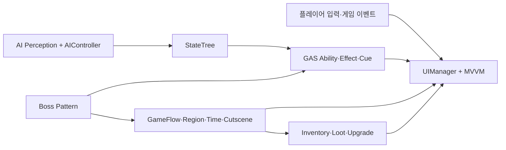

# EmptyCity — Technical Portfolio

> Unreal Engine 팀 프로젝트의 C++ 구현 일부를 분리한 기술 포트폴리오 저장소입니다.
>
> 이 문서는 현재 저장소에서 확인할 수 있는 코드 사실과 확인할 수 없는 에셋 영역을 구분해 설명합니다.

## 프로젝트 한눈에 보기

| 항목 | 내용 |
|---|---|
| 프로젝트 | `EmptyCity` |
| 형태 | 팀 프로젝트에서 포트폴리오용 C++ 소스와 플러그인 코드를 분리한 저장소 |
| 엔진 | Unreal Engine 5.5로 진행했다는 기존 문서 기록이 있으나, 이 저장소에는 `.uproject`가 없어 독립 검증 불가 |
| 주요 기술 | Gameplay Ability System, Gameplay Tags, StateTree, AI Perception, UMG, MVVM, GameInstance/LocalPlayer Subsystem |
| 주요 분석 범위 | UI 프레임워크, 적 AI, GAS 전투, 보스전, 게임 흐름, 인벤토리·파밍·강화 |
| 실행 가능 여부 | 게임용 `Content`, `Config`, `.uproject`가 없어 이 저장소만으로 빌드·실행할 수 없음 |

## 기술 문서

| 문서 | 핵심 내용 |
|---|---|
| [UI Framework](Docs/UI_Framework.md) | GameplayTag 기반 UI 생성·레이어·스택·입력 모드와 ContextActor 기반 ViewModel 주입 |
| [StateTree AI](Docs/StateTree_AI.md) | AI Perception, 전투 대상, StateTree 노드, 거리·시네마틱 일시 정지 |
| [GAS Combat](Docs/GAS_Combat.md) | 근접 Trace, 패링, GameplayEffect 계산, GameplayCue 피드백 |
| [Boss Battle](Docs/Boss_Battle.md) | 체력 임계 패턴, 순차 장판 폭발, 돌진·도약 공격, 컷씬 연계 |
| [Game Flow](Docs/GameFlow.md) | 지역 이동, 시간 진행, 체크포인트, 사망 복귀, 컷씬 조정 |
| [Inventory & Loot](Docs/Inventory_and_Loot.md) | 스택·무게·이동·소모 트랜잭션, 드롭·픽업, 파밍·강화 |
| [10페이지 PDF 제작 자료](PortfolioMaterials/PDF_Content.md) | EmptyCity에 해당하는 2~8페이지의 메시지, 도식, 캡처, 예상 질문 |

## 전체 구조



## 구현 하이라이트

### StateTree 기반 적 행동과 GAS 전투

AI Controller가 감지 정보와 전투 대상을 관리하고, StateTree 노드는 이동·사거리·쿨다운·Ability 활성 상태를 판단합니다. 공격 단계에서는 Ability, Montage 구간 Trace, GameplayEffect, GameplayCue가 순서대로 역할을 나눕니다.

```text
AI Perception → AIController → StateTree Task → Gameplay Ability
              → Montage Trace Window → Parry 또는 Damage GE
              → ExecCalc → GameplayCue / HitReaction
```

패링 시에는 공격 판정과 Weapon Trail을 즉시 정리하되, 패링 반응 Ability가 끝날 때 공격 Ability를 종료하도록 분리해 StateTree의 다음 행동 전환 시점을 맞춥니다. 세부 근거는 [StateTree AI](Docs/StateTree_AI.md)와 [GAS Combat](Docs/GAS_Combat.md)에 정리했습니다.


### GameplayTag 기반 UIManager와 MVVM

`UUIManagerSubsystem`이 GameplayTag를 키로 위젯 설정을 찾고 생성·캐싱·레이어 배치·포커스·입력 모드를 처리합니다. 위젯은 `ContextActor`를 받은 ViewModel을 주입받아 게임플레이 객체를 직접 탐색하는 책임을 줄입니다.

```text
GameplayTag 요청 → UIConfig 조회 → Widget 생성/재사용
                 → ViewModel 생성·주입 → 레이어 배치
                 → 전역/자식 스택 갱신 → 입력 모드·포커스 갱신
```


### 게임 흐름과 플레이 루프

지역 이동은 UI Fade 중 텔레포트와 최초 방문 컷씬을 수행하고, 지역 변화가 시간 진행과 체크포인트 정책으로 이어집니다. 사망 시에는 UI·입력 잠금, 아이템 손실, 시간 또는 보스 상태 복구, 리스폰, 재저장을 한 흐름에서 조정합니다.

### 인벤토리·파밍·강화

인벤토리는 슬롯과 무게 제한을 함께 검사하고, 여러 재료를 먼저 검증한 뒤 한 번에 소모하는 트랜잭션 경로를 제공합니다. 드롭 테이블 결과는 코인·즉시 획득·월드 픽업으로 분기되며, 작업대 강화는 플레이어 가방과 보관함의 재료를 합산해 처리합니다.


## 기존 README에서 이어지는 추가 구현

- **Object Indicator:** 상호작용 대상과 화면 표시를 분리한 Lyra 기반 Indicator 구조를 프로젝트에 연결했습니다. 외부 기반임을 유지해 표기합니다. [ECGameplayAbility_Interact.cpp](EmptyCity/AbilitySystem/Ability/Player/ECGameplayAbility_Interact.cpp), [ECIndicatorManagerComponent.cpp](EmptyCity/UI/IndicatorSystem/ECIndicatorManagerComponent.cpp)
- **Gameplay Message Notification:** 송신자는 GameplayTag 채널과 Payload를 전달하고 Host Widget이 알림 생성을 담당합니다. [ECGameplayMessageSubsystem.cpp](EmptyCity/Subsystem/ECGameplayMessageSubsystem.cpp), [ECNotificationHostWidget.cpp](EmptyCity/UI/Widget/Notification/ECNotificationHostWidget.cpp)
- **Progression:** 잠김, 해금, 새로 해금됐지만 아직 연출을 확인하지 않은 상태를 분리합니다. [ECProgressionSubsystem.cpp](EmptyCity/Subsystem/ECProgressionSubsystem.cpp)
- **Pannable Map:** 노드 선택 시 중심 좌표·배율·이동 목표를 계산하고 보간·경계 제한·정보창 위치를 처리합니다. [ECPannableMapWidget.cpp](EmptyCity/UI/Widget/Map/ECPannableMapWidget.cpp), [ECMapNodeInfoWidget.cpp](EmptyCity/UI/Widget/Map/ECMapNodeInfoWidget.cpp)

## 구현 상태와 검증 범위

| 영역 | 현재 코드로 확인된 상태 | 이 저장소에서 확인할 수 없는 부분 |
|---|---|---|
| UI Framework | 위젯 설정 조회, 생성·캐싱, 레이어·스택, 입력 모드, ViewModel 생성·주입 경로 존재 | Blueprint 위젯 트리, 애니메이션, MVVM 에디터 바인딩, 실제 UIConfig DataAsset 값 |
| StateTree AI | AIController의 StateTree 실행, 감지·대상·LOD, 재사용 노드 C++ 구현 존재 | StateTree 에셋의 실제 상태 그래프, 전이 조건, 노드 바인딩 값 |
| GAS Combat | 근접 Trace, 패링 분기, Damage ExecCalc, GameplayCue C++ 경로 존재 | GameplayEffect·Ability Blueprint 및 전투 피드백 DataAsset 값, 충돌 프리셋 설정 |
| Boss Battle | 체력 임계 이벤트, 장판 생성·순차 폭발, 돌진·도약 Ability, 컷씬 메시지 연계 존재 | 보스 StateTree/Ability 에셋 배치, Montage·Niagara·Sound·Decal 자산 설정 |
| Game Flow | 지역·시간·체크포인트·사망·컷씬 조정 코드 존재 | Region/Cutscene DataAsset, 맵 내 텔레포트 포인트, 실제 세이브 슬롯과 시퀀스 자산 |
| Inventory & Loot | 스택·무게·이동·소모, 드롭·픽업, 강화 트랜잭션 코드 존재 | 아이템·드롭·강화 데이터 테이블/에셋의 실제 값과 Blueprint 화면 구성 |

## Git 및 기여도 검증

### 현재 저장소 이력

- 현재 저장소에는 23개의 커밋이 있으나 대부분 날짜별 코드 업로드와 README 수정입니다.
- 원본 팀 프로젝트의 전체 커밋 그래프는 유지되어 있지 않습니다. 따라서 이 저장소의 작성자가 `Fsbsnw`라는 사실만으로 각 줄의 최초 작성자나 개인 기여도를 확정하지 않습니다.
- 최신 코드가 들어온 근거는 [`06a7c55` — 2026-10-22 코드 스냅샷](https://github.com/Fsbsnw/EmptyCity/commit/06a7c55f5e730dd910af7156541670a4addce4e2)입니다. 이 커밋은 “해당 시점에 코드가 포함됨”을 보여줄 뿐, 원본 개발 순서나 직접 작성 여부를 증명하지 않습니다.
- 로컬에서 대조한 원본 팀 저장소의 현재 `EmptyCity/Source/EmptyCity`와 이 저장소의 `EmptyCity/` C++ 소스는 파일 해시가 일치했습니다. 다만 원본 저장소가 이 포트폴리오에 포함되지 않으므로 외부 독자가 같은 검사를 재현할 수는 없습니다.

### 기여 범위 표기 원칙

| 구분 | 문서에서의 표현 |
|---|---|
| Git 메타데이터상 `Fsbsnw` 변경이 집중된 범위 | UI Framework, StateTree 노드/AIController, 보스 패턴, GameFlow의 현재 파일을 중심으로 설명하되 “직접 작성”이라고 단정하지 않음 |
| 공동·타 개발자 기반 | GAS 기반 클래스·ASC·AttributeSet, Item Definition/Instance/Fragment와 초기 인벤토리·픽업 구조는 팀 기반으로 명시 |
| 외부 기반 | Indicator/일부 Notification 및 Pickup 계열에서 확인되는 Lyra/Epic 표기, `AsyncLoadingScreen` MIT 플러그인을 별도 표기 |
| AI 보조 가능 범위 | Git 작성자 정보로 판별할 수 없으므로 지원자가 직접 생성·수정 범위를 확인하기 전에는 수작업 작성으로 표현하지 않음 |

각 상세 문서의 “기여 및 근거” 절에서 파일 단위 경계를 더 구체적으로 확인할 수 있습니다.

## 기존 README 시각 자료 보존

아래 이미지는 기존 README에 있던 외부 호스팅 자료입니다. 공개 전 원본 팀 프로젝트의 화면·에셋 공개 허가 여부를 다시 확인해야 합니다.

<details>
<summary>AI·전투·UI·진행 시스템 이미지 펼치기</summary>

#### StateTree 및 전투


#### Gameplay UI


<p>
  
  
</p>


#### 인벤토리와 지도


</details>

## 공개 전 확인 체크리스트

- [ ] 원본 팀 저장소의 소스 코드를 포트폴리오로 공개할 수 있는지 팀 규칙과 팀원 동의를 확인한다.
- [ ] 기존 README의 GitHub user-attachments 이미지가 다른 팀원의 작업물·미공개 에셋·개인정보를 노출하지 않는지 확인한다.
- [ ] GAS 기반 클래스와 초기 인벤토리 구조 등 타 팀원 기여 파일을 계속 공개할 필요가 있는지 검토하고, 필요하면 범위를 축소하거나 크레딧을 보강한다.
- [ ] Lyra/Epic 저작권 문구가 있는 Indicator, Notification, `IPickupable` 및 관련 파생 코드의 라이선스·표시 요건을 확인한다.
- [ ] `Plugins/AsyncLoadingScreen`의 MIT 라이선스와 저작권 고지를 유지하고, 포트폴리오에 플러그인 전체 소스가 필요한지 검토한다.
- [ ] `Plugins/EmptyCityAnimationTools`가 팀 공동 자산인지, 개인 공개가 허용되는지 확인한다.
- [ ] 원본 팀 저장소의 커밋 해시·URL을 공개 문서에 추가해도 되는지 확인한다. 허가 전에는 현재 포트폴리오 스냅샷 커밋만 링크한다.
- [ ] API 키·계정 정보·로컬 경로·개인정보가 문서와 추적 파일에 없는지 최종 점검한다.
- [ ] 이 저장소만으로 실행할 수 없다는 점과 제외된 Blueprint·StateTree·DataAsset의 검증 한계를 유지한다.

## 저장소 구성

```text
EmptyCity/                 # 게임 모듈 C++ 소스
Plugins/                   # AsyncLoadingScreen, EmptyCityAnimationTools
Docs/                      # 시스템별 상세 기술 문서
PortfolioMaterials/        # PDF 구성용 요약 자료
```
