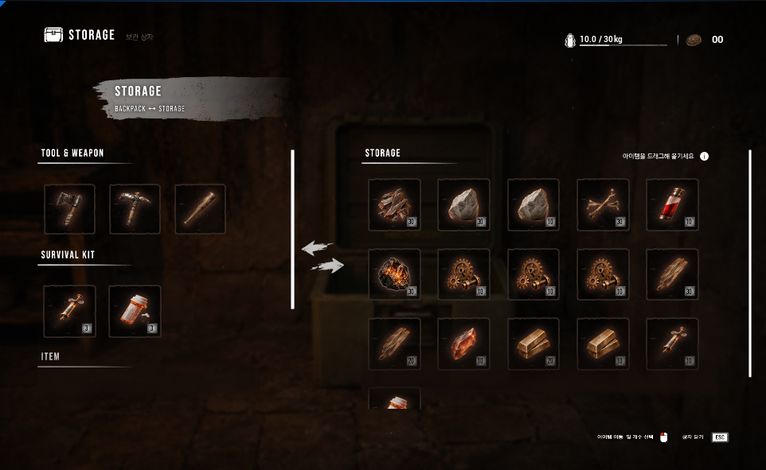
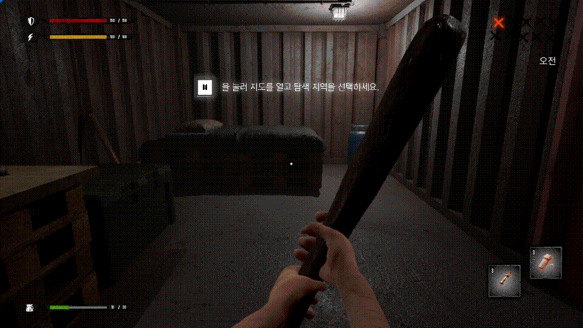
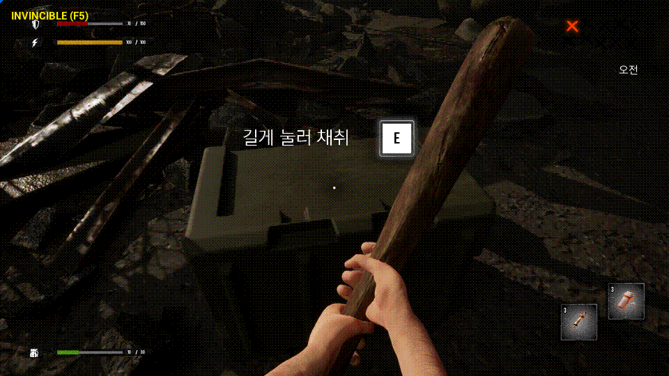
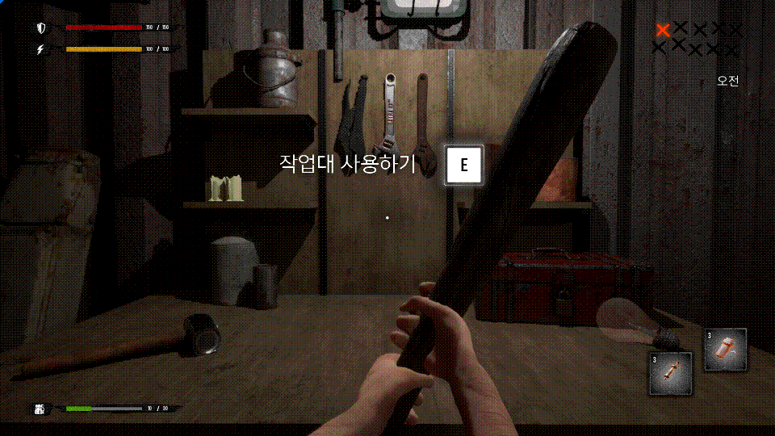

# EmptyCity

**Unreal Engine 5.5 · C++ · 3D RPG · 팀 프로젝트**

탐험과 파밍으로 자원을 확보하고 장비를 강화해 전투와 지역 진행으로 이어지는 전시용 게임 프로젝트입니다. UI 관리, 적 AI·전투 연동, 보스 패턴, 게임 진행 시스템과 자원 시스템 확장에 참여했습니다.

> [GIF 삽입: 탐험 → 파밍 → 전투를 보여주는 대표 플레이 영상]

## 대표 구현

### GameplayTag 기반 UIManager · MVVM

GameplayTag로 화면을 요청하면 UIManager가 DataAsset 설정에 따라 생성·캐싱·레이어·입력·포커스를 관리합니다. ContextActor 기반 ViewModel을 인벤토리·보관함·작업대 등에 적용했습니다.

> ### 인벤토리 및 보관함 UI
> 

[설계와 코드 보기](Docs/UI_Framework.md)

### StateTree 적 AI · GAS 전투 · 보스

AI Perception으로 감지한 대상을 AIController가 관리하고 StateTree가 행동을 선택합니다. GAS Ability로 적 공격과 패링 반응을 실행하며, 도약·장판·페이즈 전환 보스 패턴에 연계했습니다.

> ### 패링
> 

[StateTree AI](Docs/StateTree_AI.md) · [GAS 전투](Docs/GAS_Combat.md) · [보스 전투](Docs/Boss_Battle.md)

### 지역·시간·저장·컷신 흐름

지역 이동의 페이드·텔레포트·시간 경과·컷신과 사망/재도전 처리를 서브시스템 간 이벤트로 연결했습니다.

> ### 지역 이동
> 

[GameFlow 설명](Docs/GameFlow.md)

### 파밍·인벤토리·강화

월드 드롭·부분 획득·무게·슬롯 제한과 보관함 재료 소비를 작업대 강화에 연결했습니다. 초기 아이템/인벤토리 및 GAS 공통 구조는 팀 기반을 활용했습니다.

> ### 자원 채집 및 아이템 강화
> 
> 

[인벤토리·파밍 설명](Docs/Inventory_and_Loot.md)

## 기술 문서

| 시스템 | 자세히 보기 |
| --- | --- |
| UI·MVVM | [UI Framework](Docs/UI_Framework.md) |
| AI | [StateTree AI](Docs/StateTree_AI.md) |
| 공격·패링 | [GAS Combat](Docs/GAS_Combat.md) |
| 보스 | [Boss Battle](Docs/Boss_Battle.md) |
| 게임 흐름 | [GameFlow](Docs/GameFlow.md) |
| 아이템·강화 | [Inventory & Loot](Docs/Inventory_and_Loot.md) |

> 이 저장소는 포트폴리오용 C++ 코드 아카이브입니다. 게임 에셋과 `.uproject`가 포함되지 않아 단독 실행은 불가능합니다.
